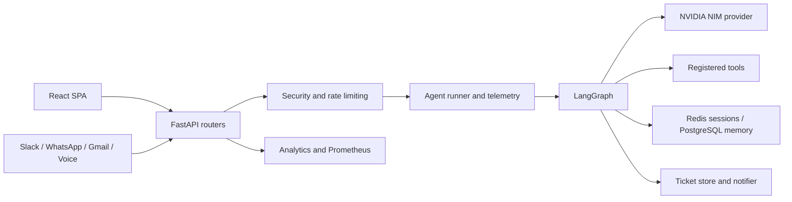

# Architecture

## Overview

The repository contains one Python backend and one separately built React single page application. The backend owns authentication, channel adapters, agent execution, persistence fallbacks, integration tools, and telemetry. The frontend calls the backend's HTTP APIs and uses WebSocket for interactive chat.

## Repository map

| Path | Responsibility |
| --- | --- |
| `app/main.py` | FastAPI application, lifespan resource setup, health endpoints, webhook handlers, and SPA delivery. |
| `app/routers/` | REST, WebSocket, voice, analytics, dashboard, and tools API routes. |
| `app/agent/` | LangGraph definition and human handoff behavior. |
| `app/runner.py` | Shared agent invocation path and per-turn telemetry across channels. |
| `app/llm/` | LLM provider contract and NVIDIA NIM HTTP client. |
| `app/tools/` | Tool contract, registry, built-in integrations, and dynamic tools. |
| `app/memory.py`, `app/tickets.py` | Session, long term memory, and handoff ticket stores. |
| `app/security.py`, `app/secrets.py`, `app/ratelimit.py` | Authentication, signature verification, secret resolution/production checks, and rate limiting. |
| `app/analytics.py`, `app/metrics.py`, `app/health.py` | In-process analytics, Prometheus metrics, and readiness checks. |
| `web/src/app/` | React application providers, navigation, layout, and command palette. |
| `web/src/features/` | Feature modules for analytics, chat, dashboard, handoff, tools, and editorial landing page. |
| `web/src/shared/` | Shared UI components, API client, auth state, formatters, and motion components. |
| `infra/` | Docker images, Compose stacks, and Prometheus/Grafana configuration. |
| `scripts/` | Developer checks, demos, and the optional Temporal worker. |
| `tests/` | Backend behavior, integration, and security tests. Frontend tests live beside the web source. |

## Request and lifecycle flow

1. `app.main` creates the FastAPI application and includes the API routers. During lifespan startup it creates the configured LLM provider, attempts Redis and PostgreSQL connections, and builds the graph with the available stores and tool registry.
2. API routers apply authentication and rate limiting where appropriate. Slack and WhatsApp webhooks verify provider signatures before scheduling a channel reply. Gmail Pub/Sub optionally validates its configured bearer token.
3. Each channel invokes `app.runner.run_agent`, which calls the graph and records request duration and turn outcome even when execution fails.
4. The LangGraph agent uses the configured LLM and registered tools, reads/writes session and long term memory, and can create a handoff ticket. Store failures degrade according to the fallback behavior in the lifespan setup.
5. The backend exposes health/readiness endpoints and Prometheus metrics. When `web/dist` exists, FastAPI serves the built UI and static assets.

## Configuration and integrations

`app/config.py` defines environment backed settings. `.env.example` lists supported configuration names. NVIDIA NIM is currently the only registered LLM provider. Redis, PostgreSQL/pgvector, Slack, WhatsApp, Google, GitHub, browser tooling, Temporal, and Sentry are optional integrations controlled by configuration and installed extras. See the source module and tests before enabling an integration in production.

## Architectural decisions

- The backend is a single deployable service. The modular boundaries are Python modules and FastAPI routers rather than separate network services.
- `app.runner` provides one invocation and telemetry boundary for API and messaging channels.
- Tool registration is explicit in `app.tools` and imported at startup to populate the registry.
- External persistence is optional for local development; fallbacks keep the API usable but do not provide durable storage.
- The frontend is feature-oriented and communicates through a shared API client. Its build is independent from the Python package and its output is served by the backend in production.
- Temporal support is an optional worker and workflow path, not required by the normal HTTP request flow.
