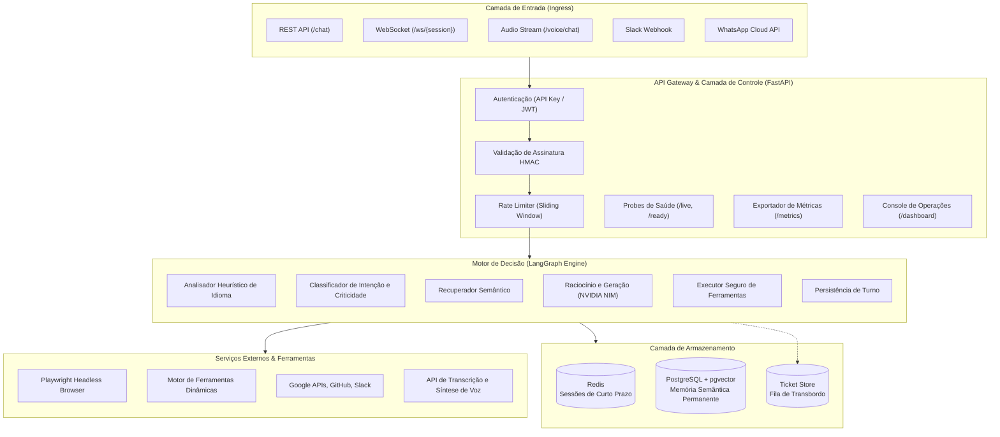

# AI Agent 24/7

Plataforma autônoma de agentes de inteligência artificial para atendimento conversacional, orquestração de processos e execução segura de ferramentas em ambientes de missão crítica.

---

## Sumário

- [1. Visão Geral](#1-visão-geral)
- [2. Arquitetura do Sistema](#2-arquitetura-do-sistema)
- [3. Máquina de Estados e Grafo de Decisão (LangGraph)](#3-máquina-de-estados-e-grafo-de-decisão-langgraph)
- [4. Módulos e Recursos Centrais](#4-módulos-e-recursos-centrais)
  - [4.1 Processamento de Voz em Tempo Real (STT + TTS)](#41-processamento-de-voz-em-tempo-real-stt--tts)
  - [4.2 Automação de Navegador Headless (Playwright)](#42-automação-de-navegador-headless-playwright)
  - [4.3 Síntese Dinâmica de Ferramentas em Runtime](#43-síntese-dinâmica-de-ferramentas-em-runtime)
  - [4.4 Detecção Automática de Idioma e Internacionalização](#44-detecção-automática-de-idioma-e-internacionalização)
  - [4.5 Controle de Vazão e Rate Limiting](#45-controle-de-vazão-e-rate-limiting)
  - [4.6 Arquitetura de Memória em Dois Níveis](#46-arquitetura-de-memória-em-dois-níveis)
  - [4.7 Protocolo de Transbordo Humano (Human Handoff)](#47-protocolo-de-transbordo-humano-human-handoff)
- [5. Segurança e Proteção de Infraestrutura](#5-segurança-e-proteção-de-infraestrutura)
- [6. Observabilidade e Telemetria](#6-observabilidade-e-telemetria)
- [7. Catálogo de Ferramentas (Tool Calling)](#7-catálogo-de-ferramentas-tool-calling)
- [8. Canais de Integração Suportados](#8-canais-de-integração-suportados)
- [9. Instalação e Execução](#9-instalação-e-execução)
  - [9.1 Pré-requisitos](#91-pré-requisitos)
  - [9.2 Execução Local com Python](#92-execução-local-com-python)
  - [9.3 Execução com Docker Compose](#93-execução-com-docker-compose)
  - [9.4 Stack de Monitoramento (Grafana + Prometheus)](#94-stack-de-monitoramento-grafana--prometheus)
- [10. Especificação da API REST e WebSockets](#10-especificação-da-api-rest-e-websockets)
- [11. Suíte de Testes e Qualidade](#11-suíte-de-testes-e-qualidade)
- [12. Estrutura do Repositório](#12-estrutura-do-repositório)
- [13. Licença](#13-licença)

---

## 1. Visão Geral

O **AI Agent 24/7** é uma solução de nível corporativo projetada para operar continuamente com alta disponibilidade, tolerância a falhas e isolamento de contexto. O sistema combina inferência local de modelos de linguagem (LLMs) acelerados via **NVIDIA NIM** com orquestração determinística baseada em grafos direcionados acíclicos e cíclicos (**LangGraph**).

### Diferenciais Operacionais

- **Zero Vendor Lock-in:** Compatível com execução on-premises via contêineres NVIDIA NIM em GPUs locais ou com provedores compatíveis com a especificação OpenAI.
- **Isolamento de Segurança:** Prevenção ativa contra vulnerabilidades SSRF (*Server-Side Request Forgery*), validação criptográfica de webhooks e gestão de credenciais via segredos montados no sistema de arquivos.
- **Resiliência Graciosa:** Degradação assistida em caso de falha de dependências externas (como Redis ou PostgreSQL), mantendo o atendimento ativo por meio de estruturas em memória volátil com alerta de saúde.
- **Intervenção Humana Contínua:** Mecanismo integrado de escalação operacional com silenciamento automático do agente, fila transacional de chamados e console administrativo em tempo real.

---

## 2. Arquitetura do Sistema

O fluxo de dados entre os componentes do sistema é estruturado em camadas desacopladas:



---

## 3. Máquina de Estados e Grafo de Decisão (LangGraph)

O fluxo conversacional não segue sequências lineares rígidas. Ele é implementado como uma máquina de estados finita que suporta iterações cíclicas controladas para execução de ferramentas (*tool calling*):

```mermaid
stateDiagram-v2
    [*] --> ClassificarIntencao: Mensagem Recebida

    state ClassificarIntencao {
        description: Avalia existência de ticket ativo ou vocabulário crítico
    }

    ClassificarIntencao --> SessaoPausada: Ticket Ativo Atribuído a Operador Humano
    ClassificarIntencao --> TransbordoHumano: Violação de Criticidade Detectada
    ClassificarIntencao --> RecuperarMemoria: Conversa Operacional Padrão

    state SessaoPausada {
        description: Registra mensagem na sessão sem disparar inferência do modelo
    }
    SessaoPausada --> [*]

    state TransbordoHumano {
        description: Emite chamado, dispara webhook corporativo e pausa sessão
    }
    TransbordoHumano --> PersistirTurno

    state RecuperarMemoria {
        description: Executa busca por similaridade de cosseno no pgvector
    }
    RecuperarMemoria --> PrepararContexto

    state PrepararContexto {
        description: Detecta idioma e monta mensagens do sistema com contexto prévio
    }
    PrepararContexto --> InferirLLM

    state InferirLLM {
        description: Executa inferência via NVIDIA NIM com catálogo de schemas
    }

    InferirLLM --> ExecutarFerramentas: Tool Call Requisitado (rounds <= 5)
    InferirLLM --> PersistirTurno: Resposta Conclusiva Gerada

    state ExecutarFerramentas {
        description: Despacha chamada com validação anti-SSRF e limites de saída
    }
    ExecutarFerramentas --> InferirLLM: Retorna saída estruturada da ferramenta

    state PersistirTurno {
        description: Atualiza buffer no Redis e indexa memória no PostgreSQL
    }
    PersistirTurno --> [*]: Resposta Transmitida ao Canal de Origem
```

---

## 4. Módulos e Recursos Centrais

### 4.1 Processamento de Voz em Tempo Real (STT + TTS)

O pipeline de voz implementado em [`app/voice.py`](app/voice.py) permite comunicação oral bidirecional:
- **Speech-to-Text (STT):** O endpoint `POST /voice/chat` aceita fluxos de áudio multipart (`audio/mpeg`, `audio/wav`, `audio/ogg`). Os bytes são transmitidos para transcrição baseada no Whisper.
- **Processamento de Diálogo:** A transcrição é submetida ao grafo do agente, preservando histórico de contexto, memória de longo prazo e acesso a ferramentas.
- **Text-to-Speech (TTS):** A resposta textual gerada pelo modelo é convertida em áudio digital via síntese neural e codificada em Base64 na resposta JSON, permitindo reprodução direta em clientes móveis ou navegadores.

### 4.2 Automação de Navegador Headless (Playwright)

A ferramenta [`PlaywrightBrowserTool`](app/tools/browser.py) supera limitações de ferramentas simples de extração HTTP baseadas em regex ou parsers estáticos:
- **Renderização Dinâmica:** Executa o runtime JavaScript completo em navegadores Chromium em modo headless.
- **Interações Avançadas:** Suporte a ações de extração de texto estruturado (`extract_text`), clique em elementos interativos (`click`), preenchimento e submissão de formulários (`fill_form`) e captura de telas completas (`screenshot`).
- **Segurança Anti-SSRF Integrada:** Toda URL submetida é inspecionada pela função `assert_public_url`, que resolve o endereço DNS em tempo de execução e rejeita hosts correspondentes a loopback, redes privadas (RFC 1918) e metadados de provedores de nuvem (`169.254.169.254`).

### 4.3 Síntese Dinâmica de Ferramentas em Runtime

O módulo [`app/tools/dynamic.py`](app/tools/dynamic.py) provê uma arquitetura extensível que permite ao próprio agente ou a operadores externos registrar novos endpoints de integração sem reiniciar a aplicação:
- **Ferramenta `create_tool`:** Permite registrar uma nova API REST informando identificador, descrição operacional, URL pública, método HTTP, cabeçalhos fixos e JSON Schema de parâmetros.
- **Instanciação Segura:** A ferramenta criada é encapsulada em uma instância de `DynamicHttpTool` e vinculada ao registro global central (`app.tools.base.registry`), tornando-se imediatamente acessível nas rodadas subsequentes de inferência.
- **Isolamento de Núcleo:** Nomes de ferramentas essenciais do sistema são blindados contra sobrescrita acidental ou maliciosa.

### 4.4 Detecção Automática de Idioma e Internacionalização

O módulo [`app/i18n.py`](app/i18n.py) garante comunicação homogênea em cenários globais:
- **Detecção Determinística:** Algoritmo heurístico baseado em frequência de vocabulário e marcadores diacríticos específicos, sem dependências de modelos pesados, suportando Português (`pt`), Inglês (`en`), Espanhol (`es`), Francês (`fr`), Alemão (`de`) e Italiano (`it`).
- **Consistência de Resposta:** O grafo injeta a restrição de idioma detectado diretamente no prompt de sistema da sessão, garantindo que o modelo responda no mesmo idioma utilizado pelo cliente.
- **Mensagens de Sistema Localizadas:** Erros operacionais, notificações de limite de requisição e avisos de transbordo humano possuem traduções pré-computadas em todos os idiomas suportados.

### 4.5 Controle de Vazão e Rate Limiting

Implementado em [`app/ratelimit.py`](app/ratelimit.py), o limitador de taxa protege os recursos computacionais do agente contra ataques de negação de serviço e consumo excessivo de cotas de inferência:
- **Algoritmo de Janela Deslizante (Sliding Window):** Utiliza filas de timestamps com descarte automático de períodos expirados e controle de concorrência com travas assíncronas.
- **Hierarquia de Identificação:** A requisição é associada sequencialmente a:
  1. Token de API / JWT (`Authorization: Bearer` ou `X-API-Key`);
  2. Identificador de Sessão (`session_id`);
  3. Endereço IP de origem (`X-Forwarded-For` ou socket direto).
- **Conformidade com Padrões HTTP:** Em caso de violação, o sistema retorna status `429 Too Many Requests` acompanhado dos cabeçalhos normativos `Retry-After`, `X-RateLimit-Limit` e `X-RateLimit-Remaining`.

### 4.6 Arquitetura de Memória em Dois Níveis

O agente utiliza uma estratégia de retenção de contexto projetada para otimizar custo e tempo de resposta:

| Nível | Camada Tecnológica | Estrutura de Dados | Política de Retenção | Finalidade |
| :--- | :--- | :--- | :--- | :--- |
| **Curto Prazo** | Redis | Listas indexadas por sessão | TTL de 24 horas (configurável) | Manutenção do histórico imediato das últimas 20 mensagens da conversa ativa. |
| **Longo Prazo** | PostgreSQL + pgvector | Vetores de 1024 dimensões com índice HNSW | Persistência definitiva | Busca semântica por similaridade de cosseno (`<=>`) para resgatar preferências e fatos históricos. |

Em cenários onde o cluster Redis ou PostgreSQL não estiver disponível, o sistema ativa automaticamente adaptadores em memória RAM (`InMemorySessionStore` e `InMemoryTicketStore`), mantendo o serviço operacional em modo degradado.

### 4.7 Protocolo de Transbordo Humano (Human Handoff)

Quando o classificador de intenção identifica linguagem de insatisfação severa ou termos legais críticos (como processos, estornos ou solicitações explícitas de operadores humanos):
1. O agente gera um ticket transacional persistido na fila operacional;
2. Um alerta é encaminhado via webhook corporativo (Slack ou Microsoft Teams) contendo identificador, canal de origem, resumo e link de atendimento;
3. A sessão é marcada com o estado `paused: true`, silenciando o agente para novas mensagens do usuário naquela sessão;
4. O operador humano assume o chamado e interage com o cliente diretamente através do Console Web (`/handoff/ui`). Ao concluir, a sessão é reativada.

---

## 5. Segurança e Proteção de Infraestrutura

- **Gestão de Segredos de Produção (`app/secrets.py`):** Resolução transparente de credenciais via volumes Docker Secrets e montagens do Kubernetes (`/run/secrets/<nome>`) ou caminhos de arquivos declarados via variáveis de ambiente (`<VAR>_FILE`). Bloqueia inicializações em produção com credenciais padrão inseguras.
- **Autenticação Flexível:** Suporte simultâneo a chaves de API estáticas e validação de tokens JWT compatíveis com padrões de mercado (Clerk, Auth0, Okta), aceitando assinaturas simétricas (HS256) e assimétricas com consulta remota de chaves (RS256 via JWKS).
- **Validação de Webhooks por HMAC SHA-256:**
  - **Slack:** Verificação da assinatura no cabeçalho `X-Slack-Signature` com rejeição de requisições com diferença temporal superior a 300 segundos (*anti-replay attack*).
  - **WhatsApp Cloud API:** Validação criptográfica do cabeçalho `X-Hub-Signature-256` utilizando o segredo do aplicativo Meta.
- **Proteção contra SSRF em Camada de Rede:** Resolução antecipada de nomes de domínio com validação contra redes locais, faixas privadas da RFC 1918 e metadados de instâncias em nuvem antes de qualquer chamada HTTP de ferramentas.

---

## 6. Observabilidade e Telemetria

### 6.1 Métricas Prometheus Centralizadas

O módulo [`app/metrics.py`](app/metrics.py) expõe telemetria operacional de alta precisão através do endpoint `/metrics`:

- `agent_requests_total`: Contador total de turnos de conversação particionado pelo canal de entrada (`rest`, `ws`, `voice`, `slack`, `whatsapp`).
- `agent_request_duration_seconds`: Histograma de latência de processamento do agente por canal, com buckets de 50ms a 10s.
- `agent_tool_calls_total`: Contador de execuções de ferramentas particionado por nome e status de execução (`success`, `error`).
- `agent_ratelimit_exceeded_total`: Contador de rejeições por excesso de requisições particionado por tipo de identificador (`api_key`, `session`, `ip`).
- `agent_tickets_active`: Indicador em tempo real de chamados de transbordo pendentes de resolução humana.
- `agent_dynamic_tools_total`: Total de ferramentas dinâmicas ativas registradas em runtime.

### 6.2 Console de Operações Web (`/dashboard`)

Interface integrada servida diretamente pela aplicação em [`app/dashboard.py`](app/dashboard.py), construída em HTML5/CSS3 moderno com tema escuro de alto contraste, tipografia técnica e atualização assíncrona periódica a cada 5 segundos:
- Indicadores numéricos de volume de requisições, chamados abertos, ferramentas ativas e bloqueios por taxa;
- Inspeção dinâmica do catálogo de ferramentas registradas;
- Visualizador direto de snapshots de telemetria e links rápidos para Prometheus e Grafana.

### 6.3 Painéis Grafana Pré-Provisionados

O repositório inclui a configuração completa de provisionamento do Grafana em [`infra/grafana/`](infra/grafana/):
- **Datasource:** Configuração automática conectando ao Prometheus local (`http://prometheus:9090`).
- **Dashboard "AI Agent 24/7 Operations":** Painel pré-configurado contendo gráficos de vazão por canal, quantis de latência (p50, p90, p95), taxa de sucesso de ferramentas e volumetria de chamados de suporte.

---

## 7. Catálogo de Ferramentas (Tool Calling)

| Identificador | Classe Implementadora | Parâmetros Principais | Descrição Operacional |
| :--- | :--- | :--- | :--- |
| `playwright_browser` | `PlaywrightBrowserTool` | `url`, `action`, `selector`, `text` | Navegação completa com execução de scripts JS, cliques, submissão de formulários e extração de texto. |
| `create_tool` | `CreateToolTool` | `name`, `description`, `url`, `method`, `parameters` | Sintetiza e registra uma nova ferramenta baseada em endpoint REST em tempo de execução. |
| `web_search` | `WebSearchTool` | `query`, `max_results` | Executa pesquisa em tempo real no DuckDuckGo retornando títulos, URLs e resumos contextuais. |
| `web_browse` | `WebBrowseTool` | `url` | Leitura simplificada de documentos HTML públicos com conversão para texto puro e proteção anti-SSRF. |
| `slack_send_message` | `SlackTool` | `channel`, `text` | Publicação de mensagens em canais ou conversas diretas no workspace do Slack via Bot Token. |
| `gmail` | `GmailTool` | `action`, `query`, `to`, `subject`, `body` | Consulta, leitura e envio de e-mails corporativos via Google Workspace REST API. |
| `google_calendar` | `CalendarTool` | `action`, `summary`, `start_time`, `end_time` | Consulta de compromissos e agendamento de eventos no Google Calendar. |
| `github` | `GitHubTool` | `action`, `repo`, `issue_number`, `title`, `body` | Consulta e abertura de issues e leitura de metadados em repositórios do GitHub. |
| `image_analysis` | `ImageAnalysisTool` | `image_url`, `prompt` | Análise multimodal de imagens e documentos através de LLMs com visão computacional. |

---

## 8. Canais de Integração Suportados

1. **REST API (`POST /chat`):** Canal síncrono padrão para integração com frontends web, microsserviços e aplicações móveis.
2. **WebSocket (`ws://.../ws/{session_id}`):** Conexão duplex contínua com suporte a streaming de turnos e verificação contínua de cota.
3. **Canal de Voz (`POST /voice/chat`):** Upload de arquivos de áudio multipart com resposta serializada contendo transcrição textual e áudio sintetizado em Base64.
4. **Slack App (`POST /webhooks/slack`):** Tratamento de menções (`app_mention`) e mensagens diretas em canais corporativos com suporte a desafios de validação de URL.
5. **WhatsApp Cloud API (`POST /webhooks/whatsapp`):** Integração com a API oficial da Meta com handshake de validação de token e resposta assíncrona.

---

## 9. Instalação e Execução

### 9.1 Pré-requisitos

- Python 3.11 ou superior
- Git
- Docker Engine e Docker Compose (para execução em contêineres)
- GPU NVIDIA com suporte a CUDA e NVIDIA Container Toolkit (opcional, para inferência local com NIM)

---

### 9.2 Execução Local com Python

```bash
# 1. Clonar o repositório
git clone https://github.com/CaioSouzx00/ai-agent-24-7.git
cd ai-agent-24-7

# 2. Configurar o arquivo de variáveis de ambiente
cp .env.example .env

# 3. Criar e ativar o ambiente virtual isolado
python -m venv .venv

# No Windows (PowerShell):
.\.venv\Scripts\Activate.ps1

# No Linux ou macOS:
source .venv/bin/activate

# 4. Instalar as dependências do projeto com suporte a ferramentas
pip install -e ".[dev,tools]"

# 5. Instalar os binários do navegador headless do Playwright
playwright install chromium

# 6. Iniciar a aplicação via Uvicorn
uvicorn app.main:app --reload --port 8080
```

---

### 9.3 Execução com Docker Compose

#### Ambiente de Desenvolvimento
Para inicializar o agente com Redis e PostgreSQL (com extensão pgvector):

```bash
docker compose -f infra/docker-compose.yml up --build -d
```

#### Ambiente com Inferência Local via GPU
Para incluir o contêiner do NVIDIA NIM rodando o modelo localmente na GPU:

```bash
export NGC_API_KEY="sua-chave-ngc-nvidia"
docker compose -f infra/docker-compose.yml --profile gpu up -d
```

#### Ambiente de Produção Hardened
A stack de produção em [`infra/docker-compose.prod.yml`](infra/docker-compose.prod.yml) inclui limites de CPU/memória, réplicas, isolamento de rede interna e gestão de segredos montados:

```bash
docker compose -f infra/docker-compose.prod.yml up -d
```

---

### 9.4 Stack de Monitoramento (Grafana + Prometheus)

Para subir o ambiente completo com Prometheus e painel Grafana pré-configurado:

```bash
docker compose -f infra/docker-compose.yml --profile monitoring up -d
```

- **Painel de Operações Web do Agente:** `http://localhost:8080/dashboard`
- **Console do Atendente Humano:** `http://localhost:8080/handoff/ui`
- **Servidor Prometheus:** `http://localhost:9090`
- **Dashboard Grafana:** `http://localhost:3000` (Credenciais padrão: `admin` / `admin`)
- **Documentação Interativa da API (OpenAPI/Swagger):** `http://localhost:8080/docs`

---

## 10. Especificação da API REST e WebSockets

| Endpoint | Método | Descrição | Requisitos de Autenticação |
| :--- | :---: | :--- | :--- |
| `/health` | `GET` | Verificação simples de liveness do processo. | Pública |
| `/live` | `GET` | Probe de liveness para orquestradores (Kubernetes/Docker). | Pública |
| `/ready` | `GET` | Diagnóstico profundo de readiness (LLM, Redis, Postgres e Circuit Breaker). | Pública |
| `/metrics` | `GET` | Exportação de telemetria no formato Prometheus. | Pública |
| `/dashboard` | `GET` | Console web operacional com telemetria e catálogo de ferramentas. | Pública |
| `/tools` | `GET` | Documentação gerada dinamicamente das ferramentas ativas. | Pública |
| `/chat` | `POST` | Processamento síncrono de mensagens de texto com rate limiting. | API Key ou JWT |
| `/voice/chat` | `POST` | Processamento de áudio via upload multipart (transcrição + síntese). | API Key ou JWT |
| `/ws/{session_id}` | `WS` | Canal duplex em tempo real via WebSocket com controle de vazão. | API Key ou JWT |
| `/tools/dynamic` | `GET` | Listagem dos schemas de todas as ferramentas criadas em runtime. | API Key ou JWT |
| `/tools/dynamic` | `POST` | Registro de uma nova ferramenta HTTP dinâmica em runtime. | API Key ou JWT |
| `/tools/dynamic/{name}` | `DELETE` | Desativação e remoção de uma ferramenta dinâmica registrada. | API Key ou JWT |
| `/handoff/ui` | `GET` | Console web administrativo para operadores humanos. | Pública (Console) |
| `/handoff/tickets` | `GET` | Listagem paginada de chamados escalados para atendimento humano. | API Key ou JWT |
| `/handoff/tickets/{id}/claim` | `POST` | Atribuição de responsabilidade por um chamado a um operador. | API Key ou JWT |
| `/handoff/tickets/{id}/reply` | `POST` | Envio de mensagem do operador humano direcionada ao canal do cliente. | API Key ou JWT |
| `/handoff/tickets/{id}/resolve` | `POST` | Conclusão do chamado e liberação do agente para reassumir o diálogo. | API Key ou JWT |
| `/webhooks/slack` | `POST` | Endpoint de recepção de eventos e mensagens do Slack App. | Assinatura HMAC Slack |
| `/webhooks/whatsapp` | `GET/POST`| Validação de handshake e recepção de mensagens da Meta. | Assinatura HMAC Meta |

---

## 11. Suíte de Testes e Qualidade

O projeto mantém uma política rigorosa de garantia de qualidade de software, auditada por ferramentas de análise estática e cobertura de testes automatizados.

### Execução dos Testes Automatizados

A suíte completa conta com **122 testes unitários e de integração** executados sem dependências externas ativas (utilizando mocks de transporte HTTP e adaptadores em memória):

```bash
# Executar todos os testes com saída verbosa
pytest -v

# Executar medição de cobertura de código
pytest --cov=app --cov-report=term-missing
```

### Scripts de Demonstração e Validação

```bash
# Demonstração interativa de chat via terminal com gerenciamento de sessão
python scripts/demo_chat.py

# Demonstração automatizada fim a fim do ciclo de transbordo humano
python scripts/demo_handoff.py

# Teste de fumaça contra modelo LLM real configurado em ambiente ativo
python scripts/smoke_llm.py
```

### Conformidade de Estilo e Análise Estática

O pipeline de pré-commit audita formatação e análise estática em conformidade com a PEP 8:

```bash
pre-commit run --all-files
```

- **Black:** Padronização uniforme de formatação de código Python.
- **Ruff:** Linter estático para detecção antecipada de más práticas, variáveis não utilizadas e complexidade ciclomática.
- **isort:** Organização determinística de importações.

---

## 12. Estrutura do Repositório

```
ai-agent-24-7/
├── app/                                 # Código-fonte principal da aplicação
│   ├── agent/                           # Orquestração do agente conversacional
│   │   ├── graph.py                     # Grafo de estados com LangGraph
│   │   └── handoff.py                   # Detecção de intenções críticas de transbordo
│   ├── llm/                             # Camada de abstração de inferência
│   │   ├── base.py                      # Contratos LLMProvider, ToolCall e LLMResponse
│   │   └── nim.py                       # Cliente para microsserviços NVIDIA NIM
│   ├── tools/                           # Ferramentas executáveis pelo agente
│   │   ├── base.py                      # Registro central e interface BaseTool
│   │   ├── browser.py                   # Navegador headless Playwright com proteção anti-SSRF
│   │   ├── dynamic.py                   # Motor de síntese de ferramentas em tempo de execução
│   │   ├── github.py                    # Integração com GitHub Issues e Repositórios
│   │   ├── google.py                    # Integração com Gmail e Google Calendar
│   │   ├── slack.py                     # Publicação de mensagens corporativas no Slack
│   │   ├── vision.py                    # Análise de imagens multimodais via LLM
│   │   ├── web.py                       # Mecanismos de busca e leitura web segura
│   │   └── integrations.py              # Inicializador e registro central das ferramentas
│   ├── static/                          # Arquivos estáticos e interfaces integradas
│   │   └── handoff.html                 # Console web do atendente humano
│   ├── channels.py                      # Roteadores de entrega para WhatsApp e Slack
│   ├── config.py                        # Centralização de configurações e variáveis de ambiente
│   ├── dashboard.py                     # Console web de operações e monitoramento
│   ├── handoff_api.py                   # API REST e controladores de transbordo humano
│   ├── health.py                        # Verificações de prontidão (readiness) e circuit breaker
│   ├── i18n.py                          # Detecção heurística de idiomas e mensagens localizadas
│   ├── main.py                          # Inicialização do FastAPI, rotas e ciclo de vida
│   ├── memory.py                        # Gestão de sessões no Redis e embeddings no pgvector
│   ├── metrics.py                       # Definições das métricas de telemetria Prometheus
│   ├── ratelimit.py                     # Controle de vazão baseado em janela deslizante
│   ├── secrets.py                       # Resolução segura de segredos montados no SO
│   ├── security.py                      # Validação de assinaturas HMAC e autenticação JWT
│   ├── tickets.py                       # Persistência de tickets e disparo de alertas
│   └── voice.py                         # Pipeline de processamento de áudio (STT + TTS)
│
├── infra/                               # Infraestrutura como código e provisionamento
│   ├── Dockerfile                       # Imagem conteinerizada de produção
│   ├── docker-compose.yml               # Orquestração local para desenvolvimento
│   ├── docker-compose.prod.yml          # Configuração de produção com restrições e réplicas
│   ├── grafana/                         # Provisionamento declarativo do Grafana
│   │   ├── dashboards/                  # Definição JSON do painel operacional
│   │   └── provisioning/                # Mapeamento automático de datasources e provedores
│   └── prometheus/                      # Configuração de coleta de métricas do Prometheus
│
├── scripts/                             # Utilitários de desenvolvimento e demonstração
│   ├── demo_chat.py                     # Interface de chat interativo em linha de comando
│   ├── demo_handoff.py                  # Automação do ciclo de vida de transbordo humano
│   ├── google_oauth_setup.py            # Assistente para emissão de credenciais OAuth do Google
│   ├── smoke_llm.py                     # Teste de fumaça de inferência com LLMs reais
│   └── temporal_worker.py               # Worker para workflows de longa duração com Temporal
│
├── docs/                                # Documentação técnica complementar
│   ├── examples/                        # Exemplos e bibliotecas operacionais
│   │   └── prompts.md                   # Catálogo de prompts estruturados para ferramentas
│   ├── architecture.md                  # Especificação complementar de arquitetura
│   └── ROADMAP.md                       # Acompanhamento das fases de entrega do projeto
│
├── tests/                               # Suíte com 122 testes automatizados
│   ├── test_browser_tool.py             # Testes unitários do PlaywrightBrowserTool
│   ├── test_channels.py                 # Testes de envio para canais externos
│   ├── test_core.py                     # Testes de fluxo básico e endpoints do FastAPI
│   ├── test_dashboard_and_dynamic_api.py# Testes do console web e API de ferramentas dinâmicas
│   ├── test_dynamic_tools.py            # Testes do motor de criação de ferramentas em runtime
│   ├── test_github_tool.py              # Testes da integração com a API do GitHub
│   ├── test_google_tools.py             # Testes das ferramentas Gmail e Google Calendar
│   ├── test_handoff.py                  # Testes da fila de tickets e protocolo de transbordo
│   ├── test_health.py                   # Testes dos diagnósticos de saúde e tolerância a falhas
│   ├── test_i18n.py                     # Testes da detecção de idiomas e internacionalização
│   ├── test_jwt_auth.py                 # Testes de validação de tokens JWT (HS256/RS256)
│   ├── test_nim_client.py               # Testes do cliente HTTP para NVIDIA NIM
│   ├── test_production.py               # Testes de resolução de segredos e validação de produção
│   ├── test_ratelimit.py                # Testes do algoritmo de rate limiting por janela deslizante
│   ├── test_security.py                 # Testes de assinaturas criptográficas HMAC e API keys
│   ├── test_session_memory.py           # Testes de persistência no Redis e vetores no pgvector
│   ├── test_tools_loop.py               # Testes do ciclo de raciocínio e execução de ferramentas
│   ├── test_vision_tool.py              # Testes da ferramenta multimodal de visão
│   └── test_voice.py                    # Testes do pipeline completo de transcrição e síntese de voz
│
├── .env.example                         # Arquivo de exemplo com todas as variáveis documentadas
├── pyproject.toml                       # Metadados do projeto, dependências e configurações
├── CONTRIBUTING.md                      # Diretrizes de contribuição e padrões de código
└── LICENSE                              # Licença de uso do software (MIT)
```

---

## 13. Licença

Este projeto é distribuído sob os termos da licença **MIT**. Consulte o arquivo [`LICENSE`](LICENSE) para obter o texto integral dos termos de uso e redistribuição.
