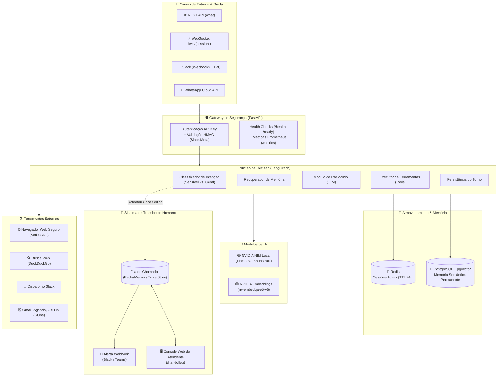
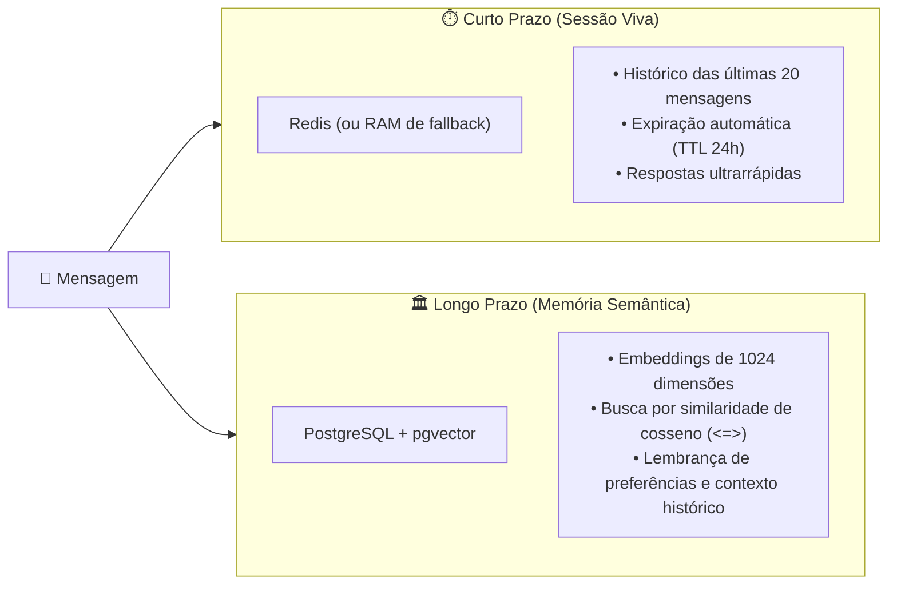
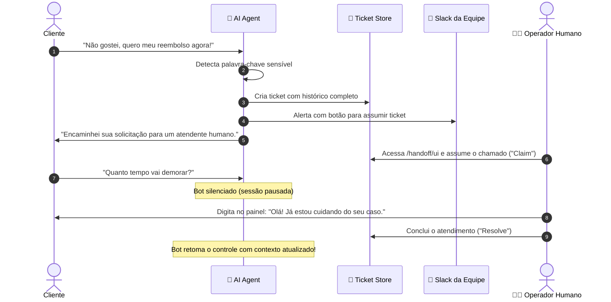

# 🤖 AI Agent 24/7

> **Agente de Inteligência Artificial autônomo, robusto e escalável para atendimento e execução de tarefas 24 horas por dia, 7 dias por semana.**  
> Alimentado por modelos locais via **NVIDIA NIM** (ou APIs em nuvem), com orquestração em grafo (**LangGraph**), memória de curto e longo prazo (**Redis + pgvector**), execução segura de ferramentas e transbordo inteligente para operadores humanos (**Human Handoff** com painel web interativo).

---

## 📑 Sumário

- [🌟 O que é este projeto? (A Analogia da Vida Real)](#-o-que-é-este-projeto-a-analogia-da-vida-real)
- [🧩 Glossário: Desmistificando Termos e Siglas](#-glossário-desmistificando-termos-e-siglas)
- [🏛️ Arquitetura do Sistema](#️-arquitetura-do-sistema)
- [🔄 Fluxo de Decisão do Agente (LangGraph)](#-fluxo-de-decisão-do-agente-langgraph)
- [🧠 Sistema de Memória em Dois Níveis](#-sistema-de-memória-em-dois-níveis)
- [👥 Transbordo Humano & Console de Atendimento](#-transbordo-humano--console-de-atendimento)
- [🛡️ Segurança e Proteções](#️-segurança-e-proteções)
- [🛠️ Ferramentas Suportadas (Tool Calling)](#️-ferramentas-suportadas-tool-calling)
- [🔌 Canais de Comunicação Suportados](#-canais-de-comunicação-suportados)
- [🚀 Como Instalar e Rodar](#-como-instalar-e-rodar)
  - [Opção 1: Com GPU Local (NVIDIA NIM via Docker)](#opção-1-com-gpu-local-nvidia-nim-via-docker)
  - [Opção 2: Sem GPU (API da NVIDIA na Nuvem)](#opção-2-sem-gpu-api-da-nvidia-na-nuvem)
  - [Iniciando o Servidor do Agente](#iniciando-o-servidor-do-agente)
- [🧪 Testes e Validação](#-testes-e-validação)
- [📡 Principais Endpoints da API](#-principais-endpoints-da-api)
- [📁 Estrutura do Código](#-estrutura-do-código)
- [🗺️ Status e Próximos Passos (Roadmap)](#️-status-e-próximos-passos-roadmap)

---

## 🌟 O que é este projeto? (A Analogia da Vida Real)

Para entender facilmente como este agente funciona, imagine uma **Central de Atendimento ao Cliente de Alto Nível**:

```
 📞 Cliente Fala        ➡️  🏢 Recepcionista (FastAPI)
                            ↳ Confere segurança e encaminha a mensagem
                                  ⬇️
                         🧠 Cérebro do Atendente (LangGraph + NVIDIA NIM)
                            ↳ Analisa o sentimento e a intenção da mensagem
                                  ⬇️
  ┌───────────────────────────────┴───────────────────────────────┐
  │                                                               │
  ▼ CASO CRÍTICO                                                  ▼ CASO ROTINEIRO
🚨 Cliente bravo ou pedido sensível              📚 Consulta a pasta de histórico (Redis)
   (ex: "Quero meu reembolso!")                  🔎 Pesquisa na biblioteca eterna (pgvector)
  │                                              🛠️ Usa a internet e ferramentas (Web Tools)
  ▼                                              💬 Responde na hora com precisão
👨‍💼 Toca o alarme e transfere na hora             │
   para um atendente humano (Human Handoff)      ▼
   pelo Console Web dedicado!                    ✅ Cliente satisfeito 24/7!
```

1. **A Recepcionista Atenta (`FastAPI`):** Recebe clientes que chegam por vários canais (site, WhatsApp, Slack). Ela confere crachás e assinaturas de segurança para garantir que ninguém tente fraudar a comunicação.
2. **O Histórico Imediato (`Redis`):** É o bloco de anotações da conversa atual. O agente se lembra do que você acabou de falar há 2 minutos sem se perder.
3. **A Biblioteca de Arquivos Antigos (`pgvector`):** É a memória de longo prazo. Se o cliente mencionou seu produto favorito há três semanas, o agente consegue resgatar essa lembrança sem esforço através de busca semântica.
4. **A Mesa de Ferramentas (`Tools`):** Quando precisa checar fatos, o agente abre a internet, lê páginas ou envia mensagens no Slack de forma controlada e segura.
5. **O Protocolo de Transbordo Humano (`Human Handoff`):** Se o cliente pedir cancelamento, ameaçar processo ou exigir um humano, o bot **não teima**: ele silencia automaticamente, abre um chamado e avisa a equipe humana via Slack com um link direto para o **Console Web**.

---

## 🧩 Glossário: Desmistificando Termos e Siglas

Aqui está um guia prático para desmistificar as siglas e conceitos técnicos do projeto:

| Sigla / Termo | Nome Completo | O que significa na prática? |
| :--- | :--- | :--- |
| **LLM** | *Large Language Model* | O "cérebro" de inteligência artificial treinado para compreender e gerar texto humano (neste caso, Llama 3.1 8B). |
| **NIM** | *NVIDIA Inference Microservice* | Um contêiner otimizado da NVIDIA que roda o modelo de IA na sua própria GPU com altíssimo desempenho e latência reduzida. |
| **RAG** | *Retrieval-Augmented Generation* | Técnica em que a IA pesquisa em um banco de dados próprio antes de responder, evitando inventar informações ("alucinações"). |
| **pgvector** | *PostgreSQL Vector Extension* | Extensão para o banco de dados Postgres que permite buscar textos por "sentido e significado", e não apenas por palavras exatas. |
| **Embeddings** | *Vetores Semânticos* | Conversão de frases em listas numéricas (coordenadas matemáticas). Frases com significados parecidos ficam "próximas" no espaço vetorial. |
| **TTL** | *Time-To-Live* | Tempo de vida útil de um dado. No Redis, as conversas temporárias expiram sozinhas após um período configurado (ex: 24 horas). |
| **LangGraph** | *LangChain State Graph* | Biblioteca para desenhar o raciocínio do agente como um fluxograma ou máquina de estados cíclica, permitindo loops de reflexão e uso de ferramentas. |
| **Handoff** | *Transbordo / Escalação* | Ato de passar o controle de uma conversa do robô para uma pessoa de carne e osso. |
| **Webhook** | *Web Callback (Gancho Web)* | Notificação automática entre sistemas via HTTP (ex: quando o WhatsApp avisa o nosso servidor que chegou mensagem nova). |
| **HMAC** | *Hash-based Message Authentication Code* | "Assinatura digital secreta". Garante que as mensagens recebidas do Slack ou WhatsApp vieram realmente dos servidores oficiais deles. |
| **SSRF** | *Server-Side Request Forgery* | Ataque cibernético onde um invasor tenta fazer o servidor acessar sua própria rede interna. Nosso agente possui proteção ativa contra isso. |

---

## 🏛️ Arquitetura do Sistema

O diagrama a seguir exibe a jornada completa de uma mensagem através dos componentes do sistema:



---

## 🔄 Fluxo de Decisão do Agente (LangGraph)

O agente não responde de maneira cega; ele segue um grafo de estados estruturado:

```mermaid
stateDiagram-v2
    [*] --> ClassificarIntencao: Mensagem recebida

    state ClassificarIntencao {
        description: Verifica se há chamado aberto ou palavras sensíveis
    }

    ClassificarIntencao --> Silencioso: Atendente humano está conversando (Pausado)
    ClassificarIntencao --> TransbordoHumano: Detectou palavra sensível (Reembolso, Processo, etc.)
    ClassificarIntencao --> RecuperarMemoria: Conversa normal

    state TransbordoHumano {
        description: Cria Ticket, Notifica Slack, Pausa Bot e responde ao cliente
    }
    TransbordoHumano --> SalvarTurno

    state Silencioso {
        description: Apenas grava o histórico e não envia resposta automática
    }
    Silencioso --> [*]

    state RecuperarMemoria {
        description: Busca memórias relevantes no Postgres (pgvector)
    }
    RecuperarMemoria --> PrepararContexto
    PrepararContexto --> PensarComLLM

    state PensarComLLM {
        description: O modelo decide: responder ou usar uma ferramenta?
    }

    PensarComLLM --> ExecutarFerramentas: LLM solicitou ferramentas (Tool Call)
    PensarComLLM --> SalvarTurno: Resposta final pronta

    state ExecutarFerramentas {
        description: Roda busca web, scraping ou Slack com limites seguros
    }
    ExecutarFerramentas --> PensarComLLM: Devolve resultado ao LLM (até 5 rodadas)

    state SalvarTurno {
        description: Salva resposta no Redis e indexa no pgvector
    }
    SalvarTurno --> [*]: Resposta entregue ao usuário
```

---

## 🧠 Sistema de Memória em Dois Níveis

O agente utiliza uma estratégia de memória inspirada no cérebro humano:



> [!NOTE]
> **Resiliência Graciosa:** Se o Redis ou o PostgreSQL estiverem fora do ar, o sistema **não trava**! Ele ativa automaticamente uma memória local em memória RAM e avisa o status degradado nos endpoints de monitoramento.

---

## 👥 Transbordo Humano & Console de Atendimento

Quando um cliente manifesta frustração ou faz uma solicitação que exige julgamento humano, o agente ativa o protocolo de transbordo:

### 1. Gatilhos de Detecção Automática
O sistema identifica termos críticos em **Português** e **Inglês**:
- *reembolso*, *cancelar contrato*, *processo judicial*, *advogado*, *fraude*, *falar com humano*, *atendente*
- *refund*, *cancel contract*, *lawsuit*, *lawyer*, *fraud*, *talk to a human*, *human agent*

### 2. O que acontece nos bastidores?
1. É gerado um **Ticket** com identificador único (ex: `a1b2c3d4`).
2. O bot envia um alerta para o canal da equipe no Slack com o resumo do problema e link de atendimento.
3. O bot **pausa suas respostas automáticas** para aquele usuário.
4. O operador humano abre o painel web em `/handoff/ui`.



### 3. Console Web Integrado (`/handoff/ui`)
O projeto vem com uma interface visual embutida, moderna e responsiva:
- 📋 **Lista e Filtros:** Visualize tickets em aberto (`open`), em atendimento (`claimed`) ou finalizados (`resolved`).
- 💬 **Visualizador de Chat:** Histórico completo com distinção visual de mensagens do usuário, do robô e do atendente.
- ✍️ **Envio Direto:** Responda ao cliente com um clique; a resposta é enviada diretamente ao canal de origem dele (WhatsApp ou Slack).

---

## 🛡️ Segurança e Proteções

Construído sob o princípio de **Defesa em Profundidade**:

- 🔑 **Autenticação Flexível:** Todas as rotas de chat e handoff exigem API Key (via cabeçalho `X-API-Key` ou `Authorization: Bearer`). No ambiente de desenvolvimento local (`APP_ENV=dev`), funciona diretamente sem complicações.
- 🔒 **Validação de Webhooks com HMAC SHA-256:**
  - **Slack:** Validação da assinatura com checagem de idade do timestamp (máximo 5 minutos) contra ataques de repetição (*replay attacks*).
  - **WhatsApp / Meta:** Validação criptográfica do cabeçalho `X-Hub-Signature-256`.
- 🌐 **Proteção Anti-SSRF (Server-Side Request Forgery):** A ferramenta de navegação web resolve o DNS antes da requisição e bloqueia qualquer endereço de loopback (`localhost`, `127.0.0.1`), faixas de rede privada (`10.0.0.0/8`, `192.168.0.0/16`, etc.) ou URLs maliciosas.

---

## 🛠️ Ferramentas Suportadas (Tool Calling)

O modelo de IA tem acesso a um catálogo padronizado de ferramentas registradas em `app/tools/base.py`:

| Ferramenta | Nome Interno | Descrição |
| :--- | :--- | :--- |
| 🌐 **Navegação Web** | `web_browse` | Baixa páginas web públicas (HTML) e extrai o texto legível com proteção contra SSRF e limites de caracteres. |
| 🔍 **Busca na Web** | `web_search` | Realiza buscas em tempo real no DuckDuckGo e retorna os links e títulos mais relevantes. |
| 💬 **Envio no Slack** | `slack_send_message` | Posta mensagens em canais ou conversas do Slack através da API oficial. |
| 📧 *Gmail (Stub)* | `gmail` | Leitura e envio de e-mails via OAuth *(pronto para plugar)*. |
| 📅 *Google Agenda (Stub)* | `google_calendar` | Consulta e agendamento de eventos *(pronto para plugar)*. |
| 🐙 *GitHub (Stub)* | `github` | Criação e consulta de Issues/PRs *(pronto para plugar)*. |
| 👁️ *Visão Computacional (Stub)* | `image_analysis` | Análise multimodal de imagens *(pronto para plugar)*. |

---

## 🔌 Canais de Comunicação Suportados

1. **REST API (`POST /chat`):** Perfeito para integração com sites, portais web e aplicações móveis.
2. **WebSocket (`ws://.../ws/{session_id}`):** Comunicação bidirecional contínua de baixa latência.
3. **Slack (`POST /webhooks/slack`):** Atendimento nativo com menções e mensagens diretas em canais da equipe.
4. **WhatsApp Cloud API (`POST /webhooks/whatsapp`):** Atendimento direto no aplicativo de mensagens mais popular do mundo.

---

## 🚀 Como Instalar e Rodar

### Pré-requisitos
- Python 3.11+
- Git
- Docker e Docker Compose (recomendado)

---

### Opção 1: Com GPU Local (NVIDIA NIM via Docker)

Se você tem uma placa de vídeo NVIDIA (com drivers e NVIDIA Container Toolkit instalados):

```bash
# 1. Defina sua chave de acesso NGC da NVIDIA
export NGC_API_KEY="sua-chave-ngc-aqui"

# 2. Inicie o microserviço NIM com suporte a GPU
docker compose -f infra/docker-compose.yml --profile gpu up nim
```
O servidor local do modelo estará disponível em `http://localhost:8000/v1`.

---

### Opção 2: Sem GPU (API da NVIDIA na Nuvem)

Não possui placa de vídeo potente no computador? Sem problemas! Você pode usar a API hospedada oficial e gratuita para testes:

1. Obtenha uma chave gratuita em [build.nvidia.com](https://build.nvidia.com).
2. Configure as seguintes variáveis no seu arquivo `.env`:
```env
LLM_PROVIDER=nim
NIM_BASE_URL=https://integrate.api.nvidia.com/v1
NIM_MODEL=meta/llama-3.1-8b-instruct
NIM_API_KEY=sua-chave-gerada-no-build-nvidia
```

---

### Iniciando o Servidor do Agente

1. **Clone o repositório e configure as variáveis de ambiente:**
   ```bash
   cp .env.example .env
   ```

2. **Crie e ative o ambiente virtual Python:**
   ```bash
   # Windows (PowerShell)
   python -m venv .venv
   .\.venv\Scripts\Activate.ps1

   # Linux / macOS
   python3 -m venv .venv
   source .venv/bin/activate
   ```

3. **Instale as dependências do projeto:**
   ```bash
   pip install -e ".[dev,tools]"
   ```

4. **Inicie o servidor com Uvicorn:**
   ```bash
   uvicorn app.main:app --reload --port 8080
   ```

5. **Faça sua primeira pergunta ao agente:**
   ```bash
   curl -X POST http://localhost:8080/chat \
     -H "Content-Type: application/json" \
     -d '{"session_id": "cliente_1", "message": "Olá! Quem é você e o que pode fazer?"}'
   ```

> [!TIP]
> **Stack Completa com Docker Compose:**
> Para subir Redis, PostgreSQL com pgvector e a aplicação juntos em um único comando:
> ```bash
> docker compose -f infra/docker-compose.yml up --build
> ```

---

## 🧪 Testes e Validação

O projeto possui uma suíte abrangente de **71 testes automatizados** cobrindo canais, segurança, memória, transbordo e ciclo de ferramentas:

```bash
# Executar todos os testes com pytest
pytest

# Teste de fogo contra um LLM real configurado (verifica chat + function calling)
python scripts/smoke_llm.py
```

---

## 📡 Principais Endpoints da API

| Rota | Método | Descrição | Autenticação |
| :--- | :---: | :--- | :---: |
| `/health` | `GET` | Health check básico de liveness (indica se a API está viva). | Pública |
| `/ready` | `GET` | Readiness detalhado (testa LLM, Redis e Postgres; retorna 200, 200 degraded ou 503). | Pública |
| `/metrics` | `GET` | Métricas operacionais em formato Prometheus. | Pública |
| `/tools` | `GET` | Documentação gerada dinamicamente das ferramentas registradas. | Pública |
| `/chat` | `POST` | Envio de mensagens em formato REST. | Requer API Key |
| `/ws/{session_id}` | `WS` | Conexão de chat em tempo real via WebSocket. | Requer API Key |
| `/webhooks/slack` | `POST` | Recebimento de mensagens e desafios de verificação do Slack. | Assinatura Slack |
| `/webhooks/whatsapp` | `GET/POST` | Verificação de token e recebimento de mensagens do WhatsApp. | Assinatura Meta |
| `/handoff/ui` | `GET` | Interface visual do painel de transbordo humano. | Pública (Console) |
| `/handoff/tickets` | `GET` | Listagem de chamados e conversas escaladas. | Requer API Key |
| `/handoff/tickets/{id}/reply` | `POST` | Envio de resposta do atendente humano para o cliente. | Requer API Key |
| `/handoff/tickets/{id}/resolve`| `POST` | Finalização de um chamado para o robô reassumir. | Requer API Key |

---

## 📁 Estrutura do Código

```
ai-agent-24-7/
│
├── app/                        # 🧠 Código fonte principal da aplicação
│   ├── agent/                  # Orquestração do agente
│   │   ├── graph.py            # Grafo de estados com LangGraph (think, tools, handoff)
│   │   └── handoff.py          # Regras e palavras-chave de detecção sensível
│   ├── llm/                    # Camada de abstração de modelos
│   │   ├── base.py             # Interface genérica LLMProvider e classes de dados
│   │   └── nim.py              # Cliente para NVIDIA NIM (OpenAI-compatible)
│   ├── tools/                  # Ferramentas acionadas pela IA
│   │   ├── base.py             # Registro central e interface BaseTool
│   │   ├── web.py              # Busca (DuckDuckGo) e leitura web com proteção anti-SSRF
│   │   ├── slack.py            # Envio de mensagens no Slack
│   │   └── integrations.py     # Inicializador e stubs (Gmail, Calendar, GitHub, Visão)
│   ├── static/                 # Interfaces web nativas
│   │   └── handoff.html        # Console de atendimento humano em Vanilla JS/CSS
│   ├── channels.py             # Despachantes de respostas para Slack e WhatsApp
│   ├── config.py               # Configurações do projeto e leitura do .env
│   ├── handoff_api.py          # Rotas REST e visualização para operadores humanos
│   ├── health.py               # Lógica de prontidão com diagnóstico de dependências
│   ├── main.py                 # Ponto de entrada FastAPI, roteadores e webhooks
│   ├── memory.py               # Sessões no Redis + busca vetorial no pgvector
│   ├── security.py             # Validação HMAC (Slack/Meta), API Keys e anti-replay
│   ├── tickets.py              # Gerenciador de tickets e alertas para a equipe
│   └── workflows.py            # Esqueleto para orquestração distribuída via Temporal
│
├── infra/                      # 🐳 Infraestrutura e deploy
│   ├── Dockerfile              # Imagem Docker otimizada da aplicação
│   └── docker-compose.yml      # Configuração com NIM, Redis, Postgres e Temporal
│
├── scripts/                    # 🧪 Scripts utilitários
│   └── smoke_llm.py            # Teste rápido de conexão e function calling com o LLM
│
├── tests/                      # 🧪 Suíte de testes unitários e de integração
│   ├── test_channels.py        # Testes de despacho para canais
│   ├── test_core.py            # Testes do fluxo básico do FastAPI
│   ├── test_handoff.py         # Testes de tickets e transbordo
│   ├── test_health.py          # Testes de verificação de saúde e falhas
│   ├── test_nim_client.py      # Testes do cliente NVIDIA NIM
│   ├── test_security.py        # Testes de validação de assinaturas e API keys
│   ├── test_session_memory.py  # Testes de Redis e pgvector
│   └── test_tools_loop.py      # Testes do loop de raciocínio e execução de tools
│
├── docs/                       # 📚 Documentação adicional
│   ├── architecture.md         # Diagrama de arquitetura simplificado
│   └── ROADMAP.md              # Quadro de tarefas e status das fases
│
├── .env.example                # Exemplo das variáveis de ambiente
├── pyproject.toml              # Dependências e metadados do pacote Python
├── CONTRIBUTING.md             # Guia de contribuição para desenvolvedores
├── CODE_OF_CONDUCT.md          # Código de conduta
└── LICENSE                     # Licença de uso (MIT)
```

---

## 🗺️ Status e Próximos Passos (Roadmap)

Consulte o arquivo [`docs/ROADMAP.md`](docs/ROADMAP.md) para detalhes completos de cada fase.

- [x] **Fase 0:** Estrutura base, linters, pre-commit e governança de código.
- [x] **Fase 1:** Integração com NVIDIA NIM (Chat e Function Calling).
- [x] **Fase 2:** Orquestração de grafo (LangGraph), sessões no Redis e memória vetorial pgvector.
- [x] **Fase 3:** Ferramentas de navegação web (anti-SSRF), busca e Slack.
- [x] **Fase 4:** Webhooks seguros com verificação HMAC para Slack e WhatsApp Cloud API.
- [x] **Fase 5:** Monitoramento (Prometheus `/metrics`), diagnósticos `/ready` e resiliência com fallback.
- [x] **Fase 6:** Transbordo humano completo com fila de tickets e Console Web interativo.
- [ ] **Fase 7:** Implementação das ferramentas de Gmail, Google Agenda e GitHub.
- [ ] **Fase 8:** Workflows avançados de longa duração com Temporal.

---

## 📄 Licença

Distribuído sob a licença **MIT**. Veja o arquivo [`LICENSE`](LICENSE) para mais informações.
