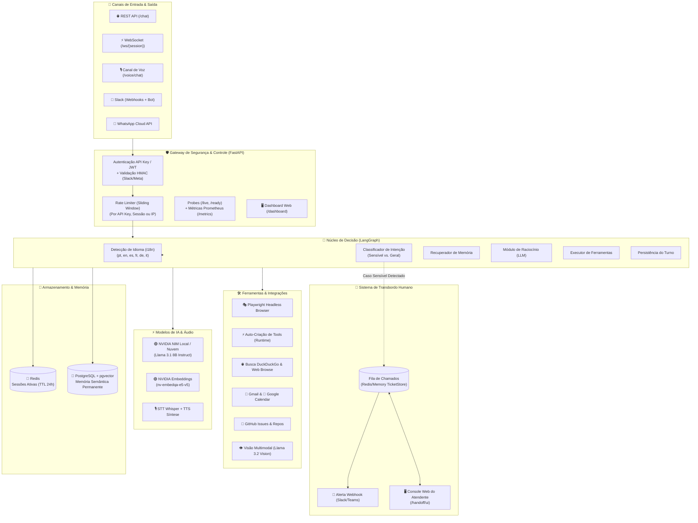
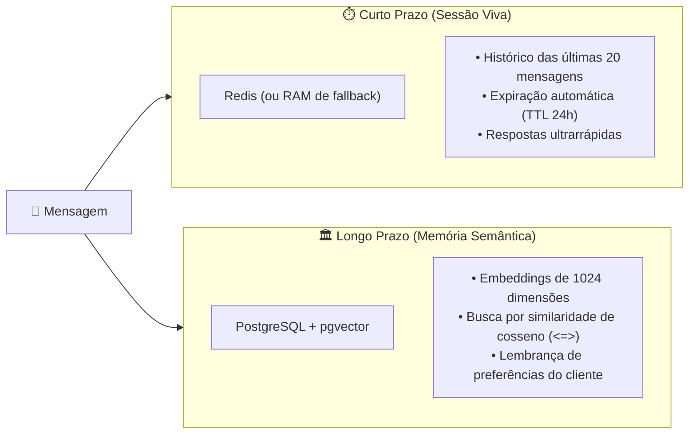
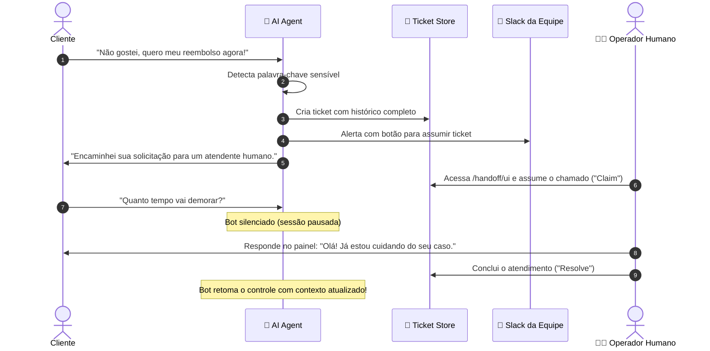

# 🤖 AI Agent 24/7

> **Agente de Inteligência Artificial autônomo, robusto e escalável para atendimento, execução de tarefas e fluxos complexos 24 horas por dia, 7 dias por semana.**  
> Alimentado por modelos locais via **NVIDIA NIM** (ou APIs em nuvem), com orquestração em grafo (**LangGraph**), memória em dois níveis (**Redis + pgvector**), suporte multilíngue automático, voz (**STT + TTS**), browser headless (**Playwright**), auto-criação de ferramentas em runtime, observabilidade total (**Prometheus + Grafana + Dashboard Web nativo**), rate limiting e transbordo humano com painel dedicado (**Human Handoff**).

---

## 📑 Sumário

- [🌟 O que é este projeto? (A Analogia da Vida Real)](#-o-que-é-este-projeto-a-analogia-da-vida-real)
- [🧩 Glossário: Desmistificando Termos e Siglas](#-glossário-desmistificando-termos-e-siglas)
- [🏛️ Arquitetura do Sistema](#️-arquitetura-do-sistema)
- [🔄 Fluxo de Decisão do Agente (LangGraph)](#-fluxo-de-decisão-do-agente-langgraph)
- [✨ Funcionalidades em Destaque](#-funcionalidades-em-destaque)
  - [🌍 Suporte Multilíngue Avançado](#-suporte-multilíngue-avançado)
  - [🎙️ Canal de Voz Completo (STT + TTS)](#️-canal-de-voz-completo-stt--tts)
  - [🎭 Headless Browser Real (Playwright)](#-headless-browser-real-playwright)
  - [⚡ Auto-Criação de Ferramentas em Runtime](#-auto-criação-de-ferramentas-em-runtime)
  - [⏱️ Rate Limiting por Usuário / API Key / Sessão](#️-rate-limiting-por-usuário--api-key--sessão)
  - [📊 Observabilidade: Dashboard Web & Grafana Stack](#-observabilidade-dashboard-web--grafana-stack)
- [🧠 Sistema de Memória em Dois Níveis](#-sistema-de-memória-em-dois-níveis)
- [👥 Transbordo Humano & Console de Atendimento](#-transbordo-humano--console-de-atendimento)
- [🛡️ Segurança, Produção & Secrets Management](#️-segurança-produção--secrets-management)
- [🛠️ Ferramentas Suportadas (Tool Calling)](#️-ferramentas-suportadas-tool-calling)
- [🔌 Canais de Comunicação Suportados](#-canais-de-comunicação-suportados)
- [🚀 Como Instalar e Rodar](#-como-instalar-e-rodar)
  - [Opção 1: Com GPU Local (NVIDIA NIM via Docker)](#opção-1-com-gpu-local-nvidia-nim-via-docker)
  - [Opção 2: Sem GPU (API da NVIDIA na Nuvem)](#opção-2-sem-gpu-api-da-nvidia-na-nuvem)
  - [Iniciando o Servidor do Agente](#iniciando-o-servidor-do-agente)
  - [Subindo a Stack de Monitoramento (Grafana + Prometheus)](#subindo-a-stack-de-monitoramento-grafana--prometheus)
- [🧪 Testes, Validação e Demos](#-testes-validação-e-demos)
- [📡 Principais Endpoints da API](#-principais-endpoints-da-api)
- [📁 Estrutura do Código](#-estrutura-do-código)
- [🗺️ Status e Próximos Passos (Roadmap)](#️-status-e-próximos-passos-roadmap)

---

## 🌟 O que é este projeto? (A Analogia da Vida Real)

Para entender facilmente como este agente funciona, imagine uma **Central de Atendimento e Operações Corporativas de Alto Nível**:

```
 📞 Cliente Fala ou Digita ➡️  🏢 Recepcionista (FastAPI + Rate Limit + Auth)
                               ↳ Valida permissões, rate limits e assinaturas HMAC
                                     ⬇️
                            🧠 Cérebro do Atendente (LangGraph + NVIDIA NIM)
                               ↳ Detecta idioma, contexto e criticidade da mensagem
                                     ⬇️
   ┌─────────────────────────────────┴─────────────────────────────────┐
   │                                                                   │
   ▼ CASO CRÍTICO                                                      ▼ CASO ROTINEIRO
🚨 Cliente bravo ou pedido sensível                  📚 Consulta o histórico da sessão (Redis)
   (ex: "Quero meu reembolso!")                      🔎 Pesquisa memórias antigas (pgvector)
   │                                                 🛠️ Navega na web com JS (Playwright)
   ▼                                                 ⚡ Cria novas tools dinamicamente (Runtime)
👨‍💼 Toca o alarme e transfere na hora                 💬 Responde no idioma do cliente (i18n)
   para um atendente humano (Human Handoff)          🎙️ Converte texto para áudio realista (TTS)
   pelo Console Web dedicado!                        │
                                                     ▼
                                                     ✅ Cliente atendido com excelência 24/7!
```

1. **A Recepcionista Atenta (`FastAPI` + `RateLimiter`):** Recebe clientes que chegam por vários canais (site, WhatsApp, Slack, Voz). Controla volume com taxa de requisições por segundo e valida credenciais e assinaturas digitais HMAC.
2. **O Ouvido Multilíngue (`i18n`):** Detecta se o cliente está falando em Português, Inglês, Espanhol, Francês ou Alemão e responde com precisão e consistência no mesmo idioma.
3. **O Histórico Imediato (`Redis`):** Guarda a memória da conversa atual com expiração automática (TTL).
4. **A Biblioteca Permanente (`pgvector`):** Guarda a memória semântica de longo prazo por busca vetorial.
5. **A Oficina de Ferramentas (`Playwright` + `Dynamic Tools`):** O agente pesquisa na web, navega em páginas interativas com cliques e preenchimento de formulários e é capaz de **gerar novas ferramentas para si mesmo** em tempo de execução.
6. **A Voz do Agente (`Whisper STT` + `TTS`):** Permite receber áudio de mensagens de voz e devolver respostas faladas naturais em base64.
7. **O Transbordo Humano (`Human Handoff`):** Quando necessário, o robô silencia, abre um chamado e notifica a equipe com link direto para o **Console Web**.
8. **A Torre de Controle (`Dashboard Web` + `Grafana`):** Acompanhamento em tempo real de latência, vazão, tickets ativos e execução de ferramentas.

---

## 🧩 Glossário: Desmistificando Termos e Siglas

| Sigla / Termo | Nome Completo | O que significa na prática? |
| :--- | :--- | :--- |
| **LLM** | *Large Language Model* | O "cérebro" de IA treinado para entender contexto e raciocinar (ex: Llama 3.1 8B Instruct). |
| **NIM** | *NVIDIA Inference Microservice* | Contêiner otimizado da NVIDIA para rodar modelos de IA com alto rendimento na GPU. |
| **LangGraph** | *LangChain State Graph* | Orquestrador de fluxo em grafo cíclico com nós de decisão, memória e chamadas de ferramentas. |
| **STT / TTS** | *Speech-To-Text / Text-To-Speech* | Transcrição de áudio para texto e sintetização de texto para áudio falado. |
| **Playwright** | *Headless Browser Automation* | Navegador real sem interface gráfica que renderiza JavaScript, clica em botões e preenche formulários. |
| **Dynamic Tools**| *Auto-Criação de Ferramentas* | Habilidade do agente de registrar endpoints de APIs externas como novas ferramentas em runtime. |
| **Rate Limiting**| *Limitador de Taxa de Requisições*| Proteção que impede abusos ou sobrecarga limitando requisições por API key, sessão ou IP. |
| **pgvector** | *PostgreSQL Vector Extension* | Extensão do Postgres que realiza buscas semânticas por proximidade de vetores (*embeddings*). |
| **Handoff** | *Transbordo Humano* | Transferência de controle da conversa do robô para um operador humano. |
| **HMAC** | *Hash-based Message Auth Code* | Validação criptográfica de autenticidade das mensagens do Slack e WhatsApp. |
| **SSRF** | *Server-Side Request Forgery* | Tentativa de fazer o servidor acessar redes internas. O agente possui proteção ativa contra isso. |

---

## 🏛️ Arquitetura do Sistema



---

## 🔄 Fluxo de Decisão do Agente (LangGraph)

```mermaid
stateDiagram-v2
    [*] --> ClassificarIntencao: Mensagem recebida

    state ClassificarIntencao {
        description: Verifica se há chamado aberto ou palavras-chave críticas
    }

    ClassificarIntencao --> Silencioso: Atendente humano está conversando (Pausado)
    ClassificarIntencao --> TransbordoHumano: Detectou palavra sensível (Reembolso, Processo, etc.)
    ClassificarIntencao --> RecuperarMemoria: Conversa normal

    state TransbordoHumano {
        description: Cria Ticket, Notifica Slack, Pausa Bot e responde no idioma correto
    }
    TransbordoHumano --> SalvarTurno

    state Silencioso {
        description: Grava no histórico sem responder (respeita o operador humano)
    }
    Silencioso --> [*]

    state RecuperarMemoria {
        description: Busca memórias no Postgres (pgvector)
    }
    RecuperarMemoria --> PrepararContexto

    state PrepararContexto {
        description: Detecta idioma (pt/en/es/...) e formata prompt com instruções consistentes
    }
    PrepararContexto --> PensarComLLM

    state PensarComLLM {
        description: O modelo decide entre responder ou acionar ferramentas
    }

    PensarComLLM --> ExecutarFerramentas: Solicitou ferramenta (Tool Call)
    PensarComLLM --> SalvarTurno: Resposta final pronta

    state ExecutarFerramentas {
        description: Roda Playwright, Dynamic Tools, GitHub, Google ou Busca Web
    }
    ExecutarFerramentas --> PensarComLLM: Retorna resultado ao modelo (até 5 iterações)

    state SalvarTurno {
        description: Grava turno no Redis e indexa no pgvector
    }
    SalvarTurno --> [*]: Resposta entregue ao usuário
```

---

## ✨ Funcionalidades em Destaque

### 🌍 Suporte Multilíngue Avançado
- **Detecção de Idioma em Tempo Real:** O módulo [`app/i18n.py`](app/i18n.py) detecta automaticamente o idioma da mensagem do usuário (`pt`, `en`, `es`, `fr`, `de`, `it`) de forma determinística e com latência zero.
- **Respostas Consistentes:** O modelo é dinamicamente instruído no system prompt a manter a comunicação no idioma original do usuário.
- **Mensagens de Sistema Localizadas:** Mensagens padrão de erro, rate limiting e transbordo humano são respondidas no idioma de origem.

### 🎙️ Canal de Voz Completo (STT + TTS)
- **Speech-To-Text (STT):** Endpoint [`POST /voice/chat`](app/main.py) que recebe arquivos de áudio multipart (`.mp3`, `.wav`, `.ogg`, `.m4a`) e transcreve usando a API Whisper/NVIDIA.
- **Orquestração de Áudio:** O áudio transcrito é processado através do grafo LangGraph com histórico de sessão e ferramentas, gerando a resposta e convertendo-a em áudio sintetizado em base64 via Text-To-Speech (TTS).

### 🎭 Headless Browser Real (Playwright)
- Substitui/complementa leitores HTML estáticos pela ferramenta [`playwright_browser`](app/tools/browser.py).
- Renderiza Single Page Applications (SPAs) modernas com JavaScript.
- Ações suportadas:
  - `extract_text`: renderiza a página completa e extrai o conteúdo legível.
  - `click`: clica em seletores CSS ou links.
  - `fill_form`: preenche campos e submete formulários.
  - `screenshot`: captura imagem visual da página em base64.
- **Anti-SSRF Rigoroso:** Bloqueio de hosts privados, endereços de loopback e metadados de nuvem.

### ⚡ Auto-Criação de Ferramentas em Runtime
- O agente possui a meta-ferramenta [`create_tool`](app/tools/dynamic.py).
- **Habilidade de Síntese:** Quando o agente ou um desenvolvedor precisa interagir com uma API externa que não estava prevista no código fonte, pode registrá-la em tempo de execução:
  - Define nome, descrição, URL de destino, método HTTP (GET/POST), cabeçalhos e JSON Schema de parâmetros.
  - A ferramenta é registrada instantaneamente no registro central e fica disponível para uso em chamadas subsequentes.
- **API REST de Gestão:** Endpoints `GET /tools/dynamic`, `POST /tools/dynamic` e `DELETE /tools/dynamic/{name}`.

### ⏱️ Rate Limiting por Usuário / API Key / Sessão
- Módulo [`app/ratelimit.py`](app/ratelimit.py) implementando algoritmo de janela deslizante (*sliding window*).
- Priorização de identificadores:
  1. `api_key`: chave de autenticação individual.
  2. `session_id`: identificador da conversa do cliente.
  3. `ip`: endereço IP de origem.
- Resposta padrão HTTP 429 com cabeçalhos informativos: `Retry-After`, `X-RateLimit-Limit` e `X-RateLimit-Remaining`.
- Proteção ativa nas rotas `/chat`, `/voice/chat` e no WebSocket `/ws/{session_id}`.

### 📊 Observabilidade: Dashboard Web & Grafana Stack
- **Dashboard Web Embutido (`GET /dashboard`):** Interface nativa em Dark Slate, moderna e responsiva, com atualização automática a cada 5 segundos exibindo KPIs em tempo real:
  - Volume de mensagens processadas por canal.
  - Chamados de transbordo humano ativos.
  - Ferramentas registradas (Core vs. Dinâmicas).
  - Bloqueios por taxa de requisições (429).
  - Snapshot ao vivo do feed Prometheus.
- **Stack Grafana & Prometheus Provisionada:**
  - `infra/prometheus/prometheus.yml`: scraping a cada 5s de `/metrics`.
  - `infra/grafana/provisioning/`: datasource e dashboard pré-configurados automaticamente.
  - `infra/grafana/dashboards/ai_agent_dashboard.json`: painéis de latência p50/p90/p99, vazão req/s, falhas de tools e chamados abertos.

---

## 🧠 Sistema de Memória em Dois Níveis



> [!NOTE]
> **Resiliência Graciosa:** Se o Redis ou o PostgreSQL ficarem indisponíveis, a aplicação faz fallback automático para memória em RAM e reporta status degradado nos endpoints de diagnóstico sem derrubar o serviço.

---

## 👥 Transbordo Humano & Console de Atendimento

Quando um cliente manifesta insatisfação ou necessidade de atendimento humano, o fluxo de transbordo é acionado:

### 1. Gatilhos de Detecção Automática
O sistema identifica termos críticos em múltiplos idiomas:
- *reembolso*, *cancelar contrato*, *processo judicial*, *advogado*, *fraude*, *falar com humano*, *atendente*
- *refund*, *cancel contract*, *lawsuit*, *lawyer*, *fraud*, *talk to a human*, *human agent*

### 2. Ciclo de Atendimento
1. É gerado um **Ticket** com histórico e motivo.
2. Alerta com link direto é postado no canal de atendimento do Slack da equipe.
3. O bot silencia e aguarda a intervenção humana.
4. O operador humano abre o **Console Web** em `/handoff/ui`.



---

## 🛡️ Segurança, Produção & Secrets Management

- 🔐 **Secrets Management (`app/secrets.py`):**
  - Resolução segura via Docker Secrets / Kubernetes (`/run/secrets/<nome>`).
  - Resolução via arquivos externos (`<VAR>_FILE`).
  - `validate_production_settings`: bloqueia inicialização em produção se tokens default inseguros forem detectados.
- 🔑 **Autenticação Dupla:** API Key simples ou validação de JWTs (Clerk / Auth0) compatível com HS256 e RS256 JWKS.
- 🔒 **Validação HMAC SHA-256:** Assinaturas digitais obrigatórias para webhooks do Slack e WhatsApp.
- 🌐 **Proteção Anti-SSRF:** Bloqueio de requisições internas na navegação web e na criação dinâmica de ferramentas.
- 🐳 **Docker Compose de Produção (`infra/docker-compose.prod.yml`):**
  - Isolamento de rede (`agent-internal`).
  - Limites de recursos (`cpu_limit`, `memory_limit`).
  - Probes avançadas de `/live` e `/ready`.
  - Configuração de rotação de logs (`json-file`, max 10m).

---

## 🛠️ Ferramentas Suportadas (Tool Calling)

| Ferramenta | Nome Interno | Descrição |
| :--- | :--- | :--- |
| 🎭 **Playwright Browser** | `playwright_browser` | Navegador headless com execução completa de JS, cliques, formulários e screenshots. |
| ⚡ **Criação de Tools** | `create_tool` | Registra novas ferramentas HTTP em runtime com validação de schema e segurança anti-SSRF. |
| 🔍 **Busca na Web** | `web_search` | Realiza buscas em tempo real no DuckDuckGo retornando títulos e links. |
| 🌐 **Navegação Web Simples** | `web_browse` | Baixa páginas web públicas (HTML) e extrai o texto legível. |
| 💬 **Envio no Slack** | `slack_send_message` | Posta mensagens em canais ou conversas do Slack através da API oficial. |
| 📧 **Gmail** | `gmail` | Leitura, busca e envio de e-mails via API do Gmail. |
| 📅 **Google Agenda** | `google_calendar` | Listagem e criação de eventos na agenda via API do Google Calendar. |
| 🐙 **GitHub** | `github` | Criação, consulta e listagem de Issues e repositórios no GitHub. |
| 👁️ **Visão Multimodal** | `image_analysis` | Análise multimodal de imagens e documentos via LLM. |

---

## 🔌 Canais de Comunicação Suportados

1. **REST API (`POST /chat`):** Integração padrão com sites, aplicativos e microsserviços.
2. **WebSocket (`ws://.../ws/{session_id}`):** Comunicação bidirecional contínua em tempo real com rate limit integrado.
3. **Canal de Voz (`POST /voice/chat`):** Upload de áudio multipart com transcrição, processamento e resposta em áudio falado.
4. **Slack (`POST /webhooks/slack`):** Atendimento nativo via menções e mensagens diretas em canais da equipe.
5. **WhatsApp Cloud API (`POST /webhooks/whatsapp`):** Atendimento no WhatsApp com verificação oficial da Meta.

---

## 🚀 Como Instalar e Rodar

### Pré-requisitos
- Python 3.11+
- Git
- Docker e Docker Compose

---

### Opção 1: Com GPU Local (NVIDIA NIM via Docker)

Se você tem placa de vídeo NVIDIA com drivers e NVIDIA Container Toolkit:

```bash
# 1. Defina sua chave de acesso NGC da NVIDIA
export NGC_API_KEY="sua-chave-ngc-aqui"

# 2. Inicie o microserviço NIM com suporte a GPU
docker compose -f infra/docker-compose.yml --profile gpu up -d nim
```
O servidor do modelo local estará disponível em `http://localhost:8000/v1`.

---

### Opção 2: Sem GPU (API da NVIDIA na Nuvem)

Você pode usar os modelos hospedados gratuitamente no catálogo da NVIDIA:

1. Obtenha sua chave gratuita em [build.nvidia.com](https://build.nvidia.com).
2. Configure o arquivo `.env`:
```env
LLM_PROVIDER=nim
NIM_BASE_URL=https://integrate.api.nvidia.com/v1
NIM_MODEL=meta/llama-3.1-8b-instruct
NIM_API_KEY=nvapi-...
```

---

### Iniciando o Servidor do Agente

1. **Clone o repositório e configure as variáveis:**
   ```bash
   cp .env.example .env
   ```

2. **Crie e ative o ambiente virtual:**
   ```bash
   # Windows (PowerShell)
   python -m venv .venv
   .\.venv\Scripts\Activate.ps1

   # Linux / macOS
   python3 -m venv .venv
   source .venv/bin/activate
   ```

3. **Instale as dependências com suporte a ferramentas e navegador:**
   ```bash
   pip install -e ".[dev,tools]"
   playwright install chromium
   ```

4. **Inicie o servidor:**
   ```bash
   uvicorn app.main:app --reload --port 8080
   ```

5. **Acesse as interfaces visuais no navegador:**
   - 📊 **Dashboard Operacional:** [http://localhost:8080/dashboard](http://localhost:8080/dashboard)
   - 👥 **Console de Transbordo Humano:** [http://localhost:8080/handoff/ui](http://localhost:8080/handoff/ui)
   - 📚 **Documentação Interativa Swagger:** [http://localhost:8080/docs](http://localhost:8080/docs)

---

### Subindo a Stack de Monitoramento (Grafana + Prometheus)

Para subir o agente junto com Prometheus e Grafana:

```bash
docker compose -f infra/docker-compose.yml --profile monitoring up -d
```
- **Prometheus:** [http://localhost:9090](http://localhost:9090)
- **Grafana:** [http://localhost:3000](http://localhost:3000) (Login padrão: `admin` / `admin`)
  - O dashboard **"AI Agent 24/7 - Operations & Quality Dashboard"** é carregado automaticamente!

---

## 🧪 Testes, Validação e Demos

O projeto conta com **122 testes automatizados** e scripts interativos de demonstração:

```bash
# Executar toda a suíte de testes unitários e de integração
pytest -v

# Demo 1: Chat Interativo via Terminal com histórico de sessão
python scripts/demo_chat.py

# Demo 2: Ciclo Completo de Transbordo Humano Automatizado
python scripts/demo_handoff.py

# Teste de fumaça com LLM real configurado
python scripts/smoke_llm.py
```

Consulte também [`docs/examples/prompts.md`](docs/examples/prompts.md) para uma biblioteca completa de prompts prontos para cada ferramenta.

---

## 📡 Principais Endpoints da API

| Rota | Método | Descrição | Autenticação |
| :--- | :---: | :--- | :---: |
| `/health` | `GET` | Liveness check básico do servidor. | Pública |
| `/live` | `GET` | Probe de liveness para orquestradores (K8s/Docker). | Pública |
| `/ready` | `GET` | Readiness detalhado (testa LLM, Redis, Postgres e Circuit Breaker). | Pública |
| `/metrics` | `GET` | Métricas operacionais no padrão Prometheus. | Pública |
| `/dashboard` | `GET` | Painel visual Dark Mode em tempo real com métricas e ferramentas. | Pública |
| `/chat` | `POST` | Envio de mensagens em formato REST (com rate limiting). | API Key / JWT |
| `/voice/chat` | `POST` | Envio de áudio via upload multipart (com transcrição e síntese). | API Key / JWT |
| `/ws/{session_id}` | `WS` | Conexão de chat bidirecional em tempo real via WebSocket. | API Key / JWT |
| `/tools` | `GET` | Documentação em Markdown de todas as ferramentas ativas. | Pública |
| `/tools/dynamic` | `GET/POST` | Listagem e criação dinâmica de novas ferramentas em runtime. | API Key / JWT |
| `/tools/dynamic/{name}` | `DELETE` | Exclusão de ferramenta dinâmica criada em runtime. | API Key / JWT |
| `/handoff/ui` | `GET` | Console visual de atendimento para operadores humanos. | Pública |
| `/handoff/tickets` | `GET` | Listagem de chamados e conversas escaladas. | API Key / JWT |
| `/handoff/tickets/{id}/reply` | `POST` | Envio de resposta do atendente humano para o canal do cliente. | API Key / JWT |
| `/handoff/tickets/{id}/resolve`| `POST` | Resolução do chamado liberando o robô para reassumir. | API Key / JWT |
| `/webhooks/slack` | `POST` | Recebimento de mensagens do Slack com verificação HMAC. | Assinatura Slack |
| `/webhooks/whatsapp` | `GET/POST` | Webhook oficial do WhatsApp Cloud API com validação Meta. | Assinatura Meta |

---

## 📁 Estrutura do Código

```
ai-agent-24-7/
│
├── app/                        # 🧠 Código-fonte principal da aplicação
│   ├── agent/                  # Orquestração do agente
│   │   ├── graph.py            # Grafo de estados LangGraph (i18n, think, tools, handoff)
│   │   └── handoff.py          # Regras e palavras-chave sensíveis
│   ├── llm/                    # Camada de abstração de modelos
│   │   ├── base.py             # Interfaces LLMProvider, ToolCall e LLMResponse
│   │   └── nim.py              # Cliente para NVIDIA NIM (OpenAI-compatible)
│   ├── tools/                  # Ferramentas acionadas pelo agente
│   │   ├── base.py             # Registro central e interface BaseTool
│   │   ├── browser.py          # Playwright headless browser com cliques e forms
│   │   ├── dynamic.py          # Auto-criação de ferramentas em runtime (anti-SSRF)
│   │   ├── github.py           # Gestão de Issues e repositórios GitHub
│   │   ├── google.py           # Gmail e Google Calendar
│   │   ├── slack.py            # Envio de mensagens no Slack
│   │   ├── vision.py           # Análise multimodal de imagens via LLM
│   │   ├── web.py              # Busca DuckDuckGo e scraping seguro
│   │   └── integrations.py     # Inicializador central de ferramentas
│   ├── channels.py             # Despacho de mensagens para Slack e WhatsApp
│   ├── config.py               # Configurações do projeto e variáveis de ambiente
│   ├── dashboard.py            # Dashboard web moderno embutido (/dashboard)
│   ├── handoff_api.py          # Rotas REST e Console Web do atendente humano
│   ├── health.py               # Diagnóstico de prontidão e circuit breaker
│   ├── i18n.py                 # Detecção de idioma e mensagens multilíngues
│   ├── main.py                 # Entrada FastAPI, roteadores, voz e webhooks
│   ├── memory.py               # Sessões Redis + busca vetorial no pgvector
│   ├── metrics.py              # Definições centralizadas de métricas Prometheus
│   ├── ratelimit.py            # Rate limiter por API Key, sessão e IP (Sliding Window)
│   ├── secrets.py              # Docker/K8s secrets mount e validação de produção
│   ├── security.py             # Validação HMAC, JWT (Clerk/Auth0) e API Keys
│   ├── tickets.py              # Gerenciador de tickets e alertas para humanos
│   └── voice.py                # Pipeline de voz (Speech-to-Text e Text-to-Speech)
│
├── infra/                      # 🐳 Infraestrutura, monitoramento e deploy
│   ├── Dockerfile              # Imagem Docker otimizada da aplicação
│   ├── docker-compose.yml      # Compose de desenvolvimento com NIM, Redis e Postgres
│   ├── docker-compose.prod.yml # Compose de produção com limites, secrets e réplicas
│   ├── grafana/                # Provisionamento e dashboards do Grafana
│   │   ├── dashboards/         # Painel oficial AI Agent 24/7 (JSON)
│   │   └── provisioning/       # Datasource Prometheus e dashboard providers
│   └── prometheus/             # Configuração de scraping do Prometheus
│
├── scripts/                    # 🧪 Scripts de demo e ferramentas
│   ├── demo_chat.py            # Chat interativo CLI para testar conversas
│   ├── demo_handoff.py         # Demonstração automatizada do ciclo de handoff
│   ├── google_oauth_setup.py   # Utilitário para gerar token OAuth do Google
│   ├── smoke_llm.py            # Teste rápido de conexão e function calling com LLM
│   └── temporal_worker.py      # Worker para workflows de longa duração
│
├── docs/                       # 📚 Documentação complementar
│   ├── examples/               # Exemplos e bibliotecas de prompts
│   │   └── prompts.md          # Biblioteca de prompts recomendados para ferramentas
│   ├── architecture.md         # Diagrama de arquitetura simplificado
│   └── ROADMAP.md              # Quadro de tarefas e status das fases
│
├── tests/                      # 🧪 Suíte com 122 testes automatizados
│   ├── test_browser_tool.py    # Testes do Playwright browser
│   ├── test_dashboard_and_dynamic_api.py # Testes do dashboard e API de dynamic tools
│   ├── test_dynamic_tools.py   # Testes da criação de tools em runtime
│   ├── test_github_tool.py     # Testes da integração GitHub
│   ├── test_google_tools.py    # Testes de Gmail e Calendar
│   ├── test_handoff.py         # Testes de tickets e transbordo humano
│   ├── test_i18n.py            # Testes de detecção de idioma e respostas consistentes
│   ├── test_jwt_auth.py        # Testes de autenticação JWT
│   ├── test_production.py      # Testes de secrets e validação de produção
│   ├── test_ratelimit.py       # Testes de rate limiting por chave/sessão
│   ├── test_vision_tool.py     # Testes da análise multimodal de imagem
│   └── test_voice.py           # Testes do pipeline STT e TTS de voz
│
├── .env.example                # Template de configuração de variáveis
├── pyproject.toml              # Metadados e dependências do pacote
├── CONTRIBUTING.md             # Padrões de código e fluxo de contribuição
└── LICENSE                     # Licença MIT
```

---

## 🗺️ Status e Próximos Passos (Roadmap)

Consulte o arquivo [`docs/ROADMAP.md`](docs/ROADMAP.md) para detalhes completos de cada fase.

- [x] **Fase 0:** Estrutura base, linters, pre-commit e governança de código.
- [x] **Fase 1:** Integração com NVIDIA NIM (Chat e Function Calling).
- [x] **Fase 2:** Orquestração de grafo (LangGraph), sessões no Redis e memória vetorial pgvector.
- [x] **Fase 3:** Ferramentas de navegação web (anti-SSRF), busca e Slack.
- [x] **Fase 4:** Webhooks seguros com verificação HMAC para Slack e WhatsApp Cloud API.
- [x] **Fase 5:** Monitoramento (Prometheus `/metrics`), diagnósticos `/ready` e resiliência com fallback.
- [x] **Fase 6:** Transbordo humano completo com fila de tickets e Console Web interativo.
- [x] **Fase 7:** Implementação das ferramentas de Gmail, Google Agenda, GitHub e Visão Multimodal.
- [x] **Fase 8:** Headless Browser real com Playwright, Canal de Voz (STT + TTS) e Deploy de Produção com Secrets.
- [x] **Fase 9:** Suporte Multilíngue avançado com detecção automática e respostas consistentes.
- [x] **Fase 10:** Rate Limiting por usuário, chave e sessão com cabeçalhos informativos HTTP 429.
- [x] **Fase 11:** Dashboard web operacional nativo e stack de observabilidade Grafana + Prometheus.
- [x] **Fase 12:** Auto-criação de ferramentas em runtime pelo agente com proteção anti-SSRF.
- [ ] **Fase 13:** Workflows de longa duração distribuídos com Temporal.

---

## 📄 Licença

Distribuído sob a licença **MIT**. Veja o arquivo [`LICENSE`](LICENSE) para mais informações.
