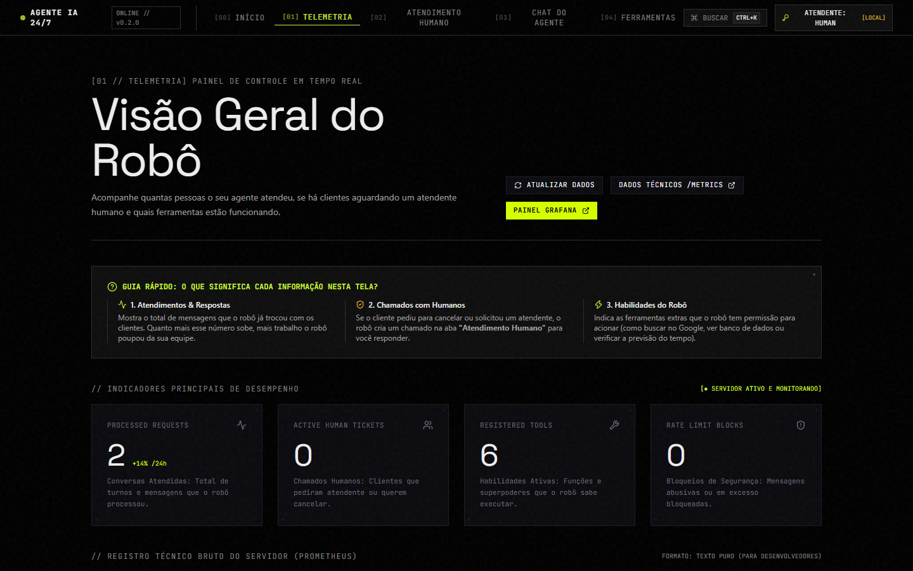
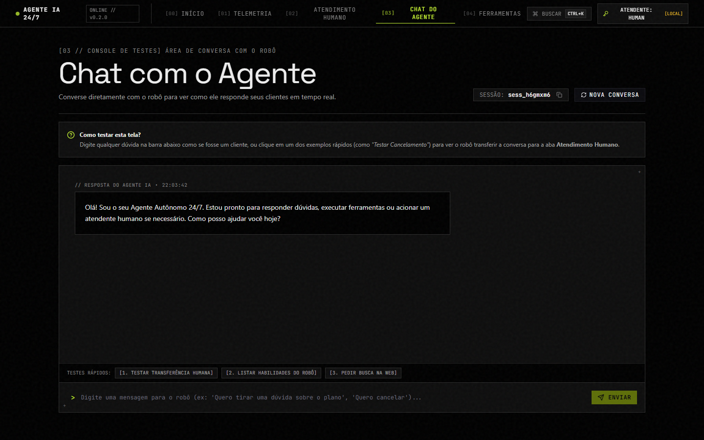
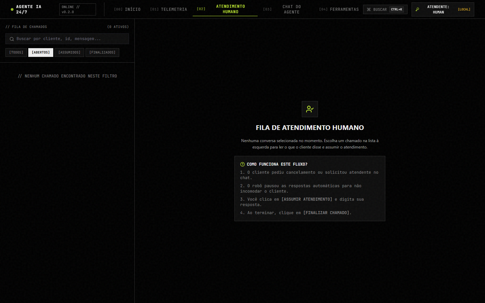
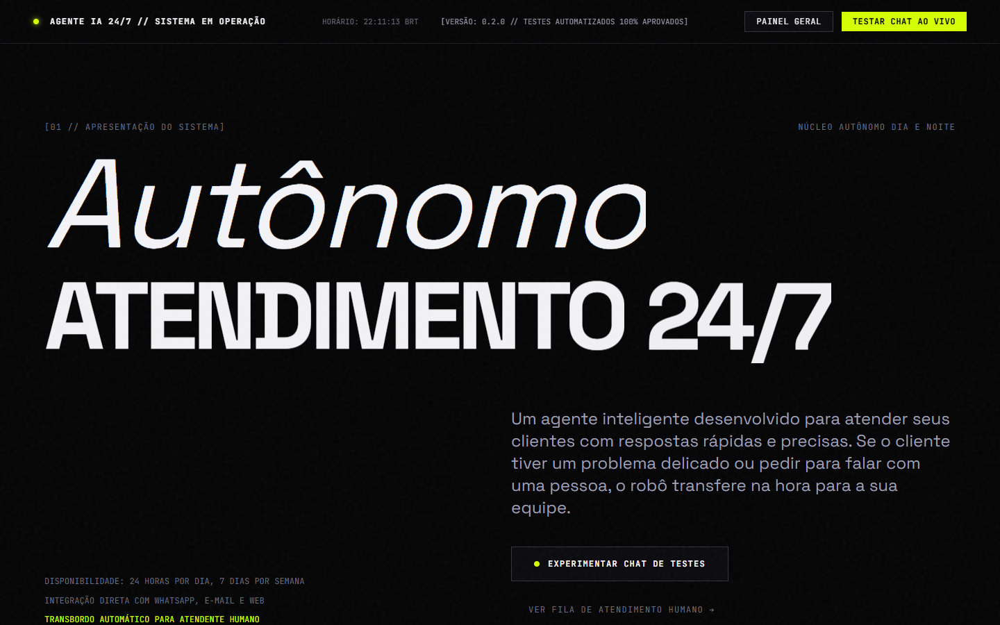
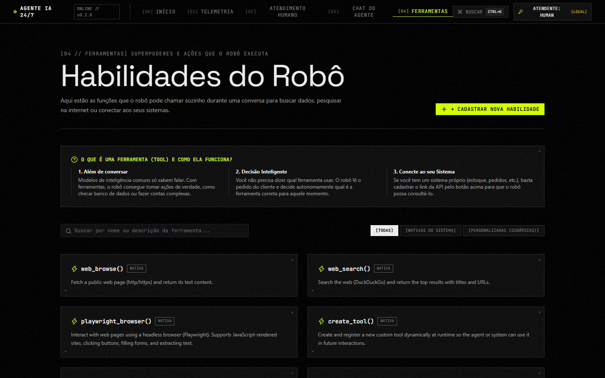
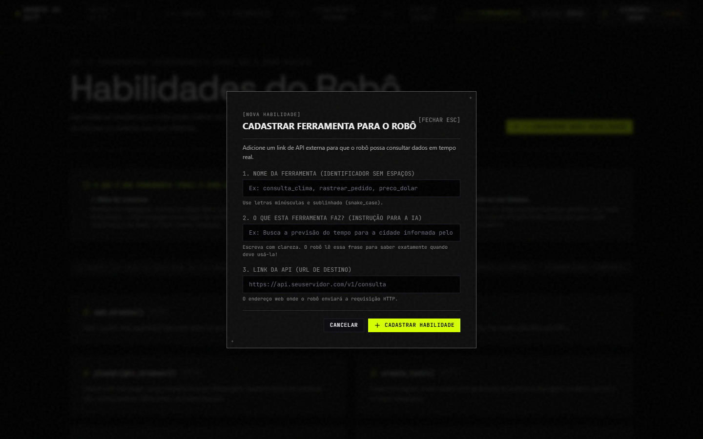
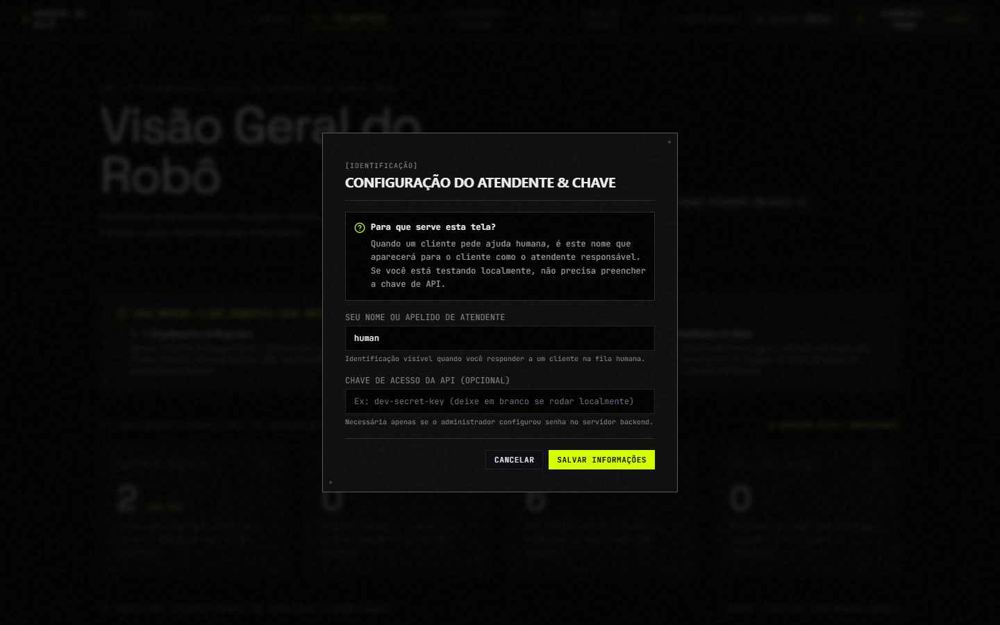
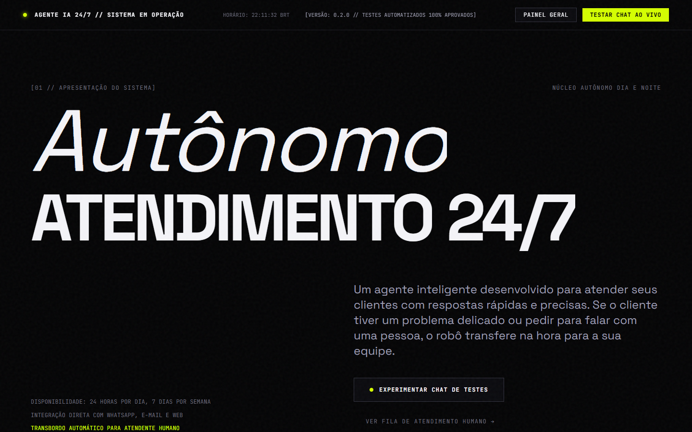

# AI Agent 24/7 - Web Frontend (SPA)

Enterprise Single Page Application (SPA) for the AI Agent 24/7 platform, delivering real-time telemetry, human handoff management, an interactive chat playground, and dynamic tool synthesis.

---

## 1. Technology Stack & Creative Design System

- **Art Direction:** Dark Editorial Brutalist com paleta **Acid Volt & Obsidian Carbon** (`#040405` e `#D4FF00`).
- **Core:** React 19 com TypeScript em modo estrito
- **Smooth Scroll & Motion:** Lenis smooth scroll, Framer Motion com easing editorial `[0.76, 0, 0.24, 1]`, cursor magnético contextual e malha topográfica 2D reativa em canvas.
- **Build Tool:** Vite com proxy dinâmico integrado para desenvolvimento
- **Routing:** TanStack Router & roteamento de rota SPA limpo
- **Server State:** TanStack Query (caching, background refetching, optimistic updates)
- **Client State:** Zustand (credenciais do operador e estado da UI em `localStorage`)
- **Forms & Schema Validation:** React Hook Form com esquemas Zod
- **Typography:** Instrument Serif (display), Syne (subtítulos e masthead), Space Grotesk (corpo) e JetBrains Mono (código e telemetria)
- **Command Palette:** cmdk (`Ctrl+K` / `Cmd+K` terminal de comandos rápido)
- **Unit Testing:** Vitest com React Testing Library e JSDOM (100% dos testes passando)

---

## 2. Visual Tour das Telas & Guia de Uso

Abaixo estão todas as 9 telas e interações modais disponíveis no frontend, com links diretos para as imagens em alta resolução e o guia prático de como utilizar cada recurso:

| Tela / Módulo | Captura em Alta Resolução | O que faz & Como usar |
| :--- | :--- | :--- |
| **01. Início / Manifesto (`/`)** |  | Portal de apresentação com manifesto editorial, malha neural 2D interativa com deformação física ao passar o mouse e formulário no rodapé para envio rápido de perguntas de teste à IA. |
| **02. Telemetria (`/dashboard`)** |  | Cockpit de métricas operacionais em tempo real: contador de conversas processadas, tickets humanos ativos, ferramentas registradas e bloqueios de segurança por rate limit. Inclui botão de sincronização e atalho para Grafana. |
| **03. Chat do Agente (`/chat`)** |  | Laboratório conversacional interativo com balões de diálogo contrastantes, badges de tool calling, atalhos prontos (teste de transbordo, listagem de ferramentas e busca web) e botão para reiniciar sessão. |
| **04. Fila de Atendimento (`/handoff`)** |  | Painel de triagem da fila de escalonamento humano com filtros por status (`Todos`, `Abertos`, `Assumidos`, `Finalizados`) e lista de chamados aguardando intervenção com indicação de motivo e canal. |
| **05. Atendimento Ativo (`/handoff`)** |  | Workspace de intervenção direta do operador humano com histórico cronológico de mensagens, botão para assumir ticket (`Claimed`), chat de resposta direta ao cliente e botão para finalizar chamado (`Resolved`). |
| **06. Matriz de Ferramentas (`/tools`)** |  | Catálogo de habilidades registradas no robô (nativas e dinâmicas) com nome técnico, descrição funcional em linguagem natural, método HTTP e botão para cadastrar novas integrações sem reiniciar o backend. |
| **07. Modal de Ferramenta Dinâmica** |  | Modal interativo para criação em tempo de execução de novas ferramentas de API, com validação de formato de rota, seleção de verbo HTTP (GET/POST) e cabeçalhos de autorização seguros. |
| **08. Identificação do Atendente** |  | Modal global de credenciais que permite ao operador definir seu nome público de assinatura nos atendimentos e configurar sua chave secreta de API (`Bearer token`) persistida no `localStorage`. |
| **09. Terminal Global (`Ctrl + K`)** |  | Paleta de comandos global acessível por atalho de teclado para navegação instantânea em milissegundos entre todas as rotas e funções do sistema. |

---

## 3. Feature-Based Architecture

The source code in `src/` enforces strict architectural boundaries to avoid coupling and circular dependencies:

```
src/
├── app/                  # Application layer: Layout, TanStack router, Command Palette, Providers
├── features/             # Domain modules (Feature-Based)
│   ├── dashboard/        # Operational metrics, KPI counters, Prometheus snapshots
│   ├── handoff/          # Operator ticket console (status filtering, claim, live chat, resolve)
│   ├── chat/             # Conversational playground (REST and audio streaming)
│   └── tools/            # Tool catalog and dynamic tool creation modal
├── shared/               # Cross-cutting reusable assets
│   ├── ui/               # Design system primitives (Button, Input, Badge, Card, Command, etc.)
│   ├── lib/              # Central typed api-client, auth-store, date/time formatters
│   └── config/           # Route paths, API endpoints, and configuration constants
└── styles/               # HSL theme variables, typography, and utility classes
```

### Boundary Rules Enforced by Linter

- `shared/` modules cannot import from `features/` or `app/`.
- `features/` modules cannot import from `app/`.
- Features communicate through well-defined exports.

---

## 4. Development & Build Commands

```bash
# Install dependencies
npm install

# Start development server with Hot Module Replacement (HMR)
# Runs on http://localhost:5173 with proxy to backend on http://localhost:8080
npm run dev

# Regenerate TypeScript API types from backend OpenAPI schema
npm run gen:api

# Type-check TypeScript files
npm run typecheck

# Run architecture boundary and code quality linter
npm run lint

# Run unit tests
npm test

# Build production bundle (outputs to web/dist/)
npm run build

# Preview production build locally
npm run preview
```

---

## 5. Production Integration with Backend

When built via `npm run build`, production assets are emitted to `web/dist/`.

The FastAPI backend automatically serves:
- `web/dist/index.html` on routes `/`, `/dashboard`, and `/handoff/ui`;
- Static bundles and stylesheets on `/assets/*`;
- Fallback content for headless environments where the front has not been pre-compiled.
